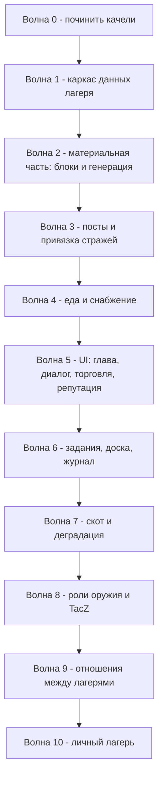

# PROJECT_VISION.md — SurvivalPoints

> **Единый документ проекта**: на чём пишем, что это за мод, что в ней должно быть и в каком порядке.
> Детальный план системы лагерей — в [`DESIGN_CAMP_SYSTEM.md`](../Camp/DESIGN_CAMP_SYSTEM.md).
> Техническое состояние кода и правила работы — в [`AI_CONTEXT.md`](../../../src/main/java/com/phian404/survivalpoints/AI_CONTEXT.md).

---

## 1. Среда разработки

| Параметр | Значение | Где задано |
|---|---|---|
| Загрузчик | **Minecraft Forge 47.4.28** | [`gradle.properties`](../../../gradle.properties) |
| Версия игры | **1.20.1** (диапазон `[1.20.1,1.21)`) | [`gradle.properties`](../../../gradle.properties) |
| Java | **17** | `sourceCompatibility` в [`build.gradle`](../../../build.gradle) |
| Маппинги | **official (Mojang)** | [`build.gradle`](../../../build.gradle) |
| Mod id | `survivalpoints` | [`SurvivalPointsMod.MOD_ID`](../../../src/main/java/com/phian404/survivalpoints/SurvivalPointsMod.java:11) |
| IDE | VS Code + расширения Java/Gradle | `.vscode/` |
| Сборка | `gradlew.bat compileJava` (~15–30 с), запуск клиента — `gradlew.bat runClient` | [`gradlew.bat`](../../../gradlew.bat) |
| Рабочий мир для тестов | `run/saves/Новый мир` | — |


**Карта пакетов** (ориентир, может устареть — сверять с рабочим деревом):

```
com.phian404.survivalpoints
├── SurvivalPointsMod.java       — точка входа (@Mod)
├── AI_CONTEXT.md                — состояние кода, правила работы, диагностика
├── ModConstants.java, ModModelLayers.java
├── client/                      — ModEntityRenderers (рендер NPC и стража), CustomWeaponLayer
├── entity/                      — BaseSurvivorEntity (общая база), BaseSurvivorNpcEntity,
│                                  BaseGuardianEntity, GuardianMoveControl
│   ├── ai/                      — цели ИИ стража
│   └── role/                    — SurvivorRole, RoleAssignmentService
├── camp/                        — данные лагеря и генерация
│   ├── CampTuning, CampRecord, CampPost, CampRelation, CampSavedData, CampManager
│   ├── CampBlueprintParser, CampGenerator
│   ├── block/CampRadioBlock
│   └── blockentity/CampRadioBlockEntity
├── init/                        — ModEntities, ModBlocks, ModCreativeTabs, Tuning,
│                                  события, команды диагностики
└── (будущее) weapon/            — слой оружия
```

**Правила окружения:**
- Бэкапы — в [`backups/`](backups/) (**вне** `src/main/java`, иначе дубликаты классов ломают компиляцию).
- Декомпилированные исходники Minecraft 1.20.1 для сверки API — `backups/_inspect_*.java`.
- Ошибки компиляции читать с первого сообщения — каскадные исключения внизу вводят в заблуждение.

---

## 2. Что это за мод

**SurvivalPoints** — постапокалиптический мод на Forge 1.20.1 про **обживание мира выжившими**: лагеря, стражи, ресурсы, ночь, радио и торговля.

SurvivalPoints предназначен для зомби-апокалиптических сборок Minecraft, но должен оставаться самостоятельным модом. Его архитектура должна позволять сторонним разработчикам создавать аддоны, добавляющие новые фракции, лагеря, NPC, блоки, задания и игровые механики, а также изменяющие баланс и поведение существующих систем без необходимости изменять исходный код основного мода.

Количество фракций и вариантов лагерей не должно быть жёстко ограничено стартовым контентом. Интеграции с оружейными модами, например TacZ, должны быть опциональными.

Главная сущность текущей разработки — [`BaseGuardianEntity`](../../../src/main/java/com/phian404/survivalpoints/entity/BaseGuardianEntity.java), гуманоидный страж-лучник. Он умеет искать врага, отступать, звать союзников, есть хлеб, стрелять из арбалета с упреждением, доворачивать корпус и голову к цели.

Но страж — **часть лагеря, а не самоцель**. Главная механика мода впереди — **лагерь**: материальный, автономный, с постами, воротами, фермой, главой и собственной экономикой.

---

## 3. Видение: список механик

### 3.1 Ядро (реализовано или в работе)

| # | Механика | Статус |
|---|---|---|
| 1 | Навигация вместо самодельного обхода (прыжки, выход из ямы) | ✅ |
| 2 | Стрельба из арбалета: урон, упреждение цели, гравитация, отброс точки появления | ✅ |
| 3 | Разворот корпуса и головы к цели; выстрел только при наведении | ✅ |
| 4 | Состояния `IDLE / RANGED / MELEE / PANIC`, автосмена оружия | ✅ |
| 5 | Зов союзников (`callForHelp`) и сбор (`rallyTo`) | ✅ |
| 6 | Восстановление HP хлебом | ✅ |
| 7 | Диагностическая команда `/sp_guard` | ✅ |

### 3.2 Лагерь (главный блок, подробно — в [`DESIGN_CAMP_SYSTEM.md`](../Camp/DESIGN_CAMP_SYSTEM.md))

| # | Механика | Статус |
|---|---|---|
| 8 | Материальный лагерь: забор, ворота, вышки, склад; **якорь — радио вышка** | Проект |
| 9 | Посты (у забора / на вышке / у ворот / патруль) и распределение стражей | Проект |
| 10 | Зона тревоги: `ALERT` / `DEFEND`; вне зоны — враги игнорируются | Проект |
| 11 | Ночной режим: ворота закрыты, ловушки активны, радио выключено | Проект |
| 12 | Штат: минимум 8 стражей, проверка раз в 5 минут, пополнение | Проект |
| 13 | Радио вышка → призыв выживших → вербовка; якорь лагеря, его разрушение = распад лагеря | Проект |
| 14 | Глава лагеря — **своя сущность со своим интерфейсом**: диалоги, торговля, репутация | Проект |
| 15 | Теплица и ферма: пшеница → хлеб → снабжение стражей | Проект |
| 16 | Ловушки (шипы/петля/сигнал) на подходах к воротам | Проект |
| 17 | Деградация: разрушенный забор → провал в безопасности → починка | Проект |
| 18 | Отношения между лагерями: дружба/вражда, торговля по радио | Проект (задел) |
| 19 | Личный лагерь игрока: **не более одного**, якорь — его радио вышка | Проект |
| 20 | Роли оружия: у обычных — старое, у главы — сильнее; **снайперы на ночном дежурстве** | Проект |
| 21 | Задания, **доска объявлений** и **журнал** по отдельной кнопке, репутация лагерей и их координаты | Проект |
| 22 | Теплица, фермер-житель, NPC-грузчик; скот (куры/коровы) с последствиями при убийстве | Проект |
| 23 | Интеграция с **TacZ** (soft-dep): огнестрел у стражей, патроны как ресурс | Проект, отложен |

### 3.3 Что может вырасти из этого (задел на будущее)

- Бандиты/мутанты, заинтересованные в лагерях (прямая причина появления постов и ловушек).
- Карта мира с торговыми путями между лагерями.
- Разные типы лагерей (аванпост, укреплённая база, аванпост-ферма).
- Караван/обоз между лагерями.
- Ресурсы и крафт, привязанные к лагерю (улучшенный арбалет, бинты, патроны).

---

## 4. Три уровня «реализма» — что нужно помнить при разработке

1. **Скрытность.** Стражи не должны привлекать внимание: не бегают по миру, не ищут врагов вне зоны тревоги, не стреляют без цели.
2. **Материальность.** Лагерь должен **быть виден**: забор, ворота, вышки, теплица. Игрок должен узнать лагерь по силуэту, а не по подсказке в чате.
3. **Автономность.** Лагерь работает без игрока: днём ферма кормит стражей, ночью ворота закрыты, радио зовёт новых.

---

## 5. Принципы проектирования

- **Один логический блок за раз.** Навигацию, движение и стрельбу не смешивать в один патч.
- **Сверка API по исходникам.** Декомпилированные исходники 1.20.1 — в `backups/_inspect_*.java`; при сомнении читать их, а не полагаться на память.
- **Сверка с ванилью.** Перед новой механикой — найти ванильный аналог и понять, почему он так сделан.
- **Бэкап перед каждой серией правок** в `backups/pre_*`.
- **Диагностика.** Каждая неочевидная механика получает вывод в `/sp_guard` или `/sp_camp`.
- **Константы — в одном месте.** Сейчас это [`GuardianTuning`](../../../src/main/java/com/phian404/survivalpoints/init/GuardianTuning.java); для лагеря — отдельный `CampTuning`.
- **Никакой «магии».** Если поведение нельзя объяснить одним предложением — оно переусложнено.

---

## 6. Дорожная карта

> Полный глобальный план (волны, приоритеты, зависимости, анти-бэклог, иллюзии, риски, бюджеты) —
> в [`ROADMAP.md`](../Roadmap/ROADMAP.md).

**Канонический источник порядка волн и приоритетов — [`ROADMAP.md`](../Roadmap/ROADMAP.md) §2.**
Схема ниже повторяет его для наглядности; при любом расхождении приоритет у `ROADMAP.md`.



Детализация критериев готовности — в [`DESIGN_CAMP_SYSTEM.md`](../Camp/DESIGN_CAMP_SYSTEM.md) §18–19
(нумерация там не каноническая).

---

## 7. Документы проекта

| Документ | О чём | Статус |
|---|---|---|
| [`PROJECT_VISION.md`](PROJECT_VISION.md) | Этот файл: среда, видение, список механик, краткая дорожная карта | обзор |
| [`ROADMAP.md`](../Roadmap/ROADMAP.md) | **Канон порядка и приоритетов**; зависимости, анти-бэклог, иллюзии, риски, бюджеты, git | канон |
| [`plan.md`](../Entities/plan.md) | **Канон архитектуры NPC**: общая база, identity UUID, `RoleAssignmentService` | канон, реализовано |
| [`DESIGN_CAMP_SYSTEM.md`](../Camp/DESIGN_CAMP_SYSTEM.md) | ТЗ базовой системы лагерей: модель, блоки, посты, ночь, штат, ферма, радио, данные | спецификация |
| [`DESIGN_CAMP_SOCIAL.md`](../Camp/DESIGN_CAMP_SOCIAL.md) | Социально-экономический слой: глава и UI, торговля, репутация, задания и журнал, ферма и скот, роли оружия, генерация лагеря | спецификация |
| [`NPC_CAMP_SIMULATION_DESIGN.md`](../Entities/NPC_CAMP_SIMULATION_DESIGN.md) | Модель NPC (тип/профессия/навыки/назначение/лидерство), навыки 0–10, симуляция лагерей, население | концепция, частично согласовано |
| [`RADIO_TOWER_DETAIL.md`](../Camp/RADIO_TOWER_DETAIL.md) | Детали радио-вышки как якоря лагеря | спецификация |
| [`WAVE2_PLAN.md`](../_archive/WAVE2_PLAN.md) | План волны 2: блоки и генерация лагеря | план волны |
| [`GUARDIAN_REWORK_PLAN.md`](../Combat/GUARDIAN_REWORK_PLAN.md) | Реворк ИИ стража R0.0–R0.6 | план, частично выполнен |
| [`TESTING.md`](../Testing/TESTING.md) | Чек-листы проверки по волнам и формат отчёта | спецификация |
| [`CREATIVE_TAB_PLAN.md`](../Items/CREATIVE_TAB_PLAN.md) | Вкладка креатива и яйца призыва | план |
| [`CAMP_IDEAS.md`](../Camp/CAMP_IDEAS.md) | **Банк идей**, не утверждённый план | идеи |
| [`AI_CONTEXT.md`](../../../src/main/java/com/phian404/survivalpoints/AI_CONTEXT.md) | Текущее состояние кода, правила работы, диагностика | контекст |
| [`changelog.txt`](../../../changelog.txt) | История изменений релиза | история |
