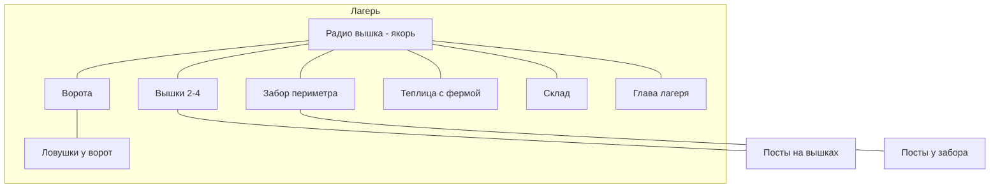
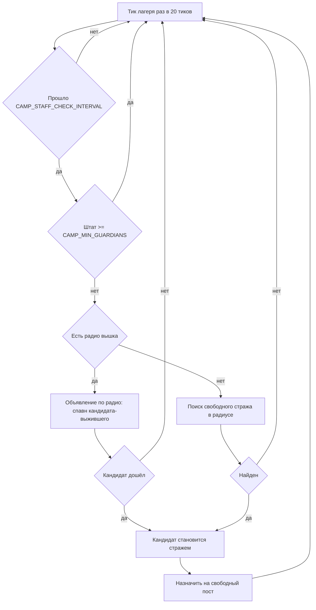
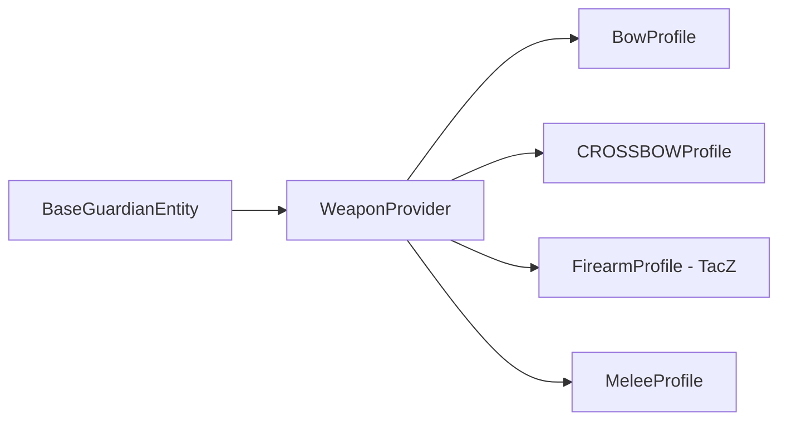
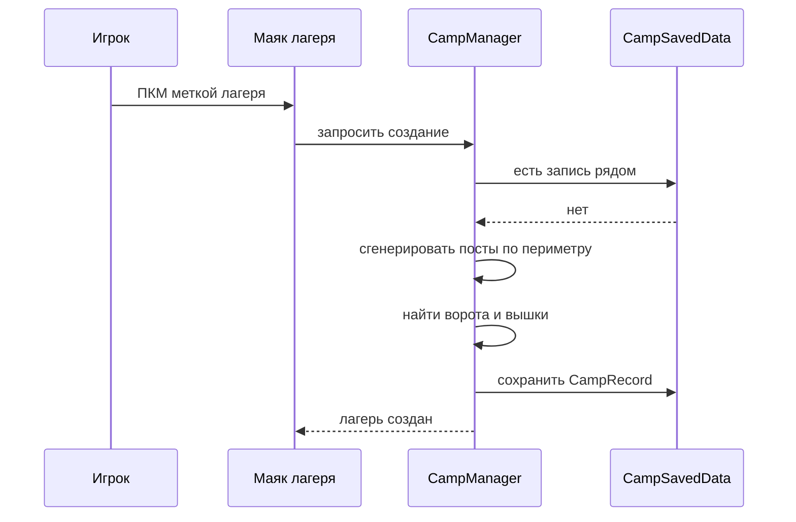
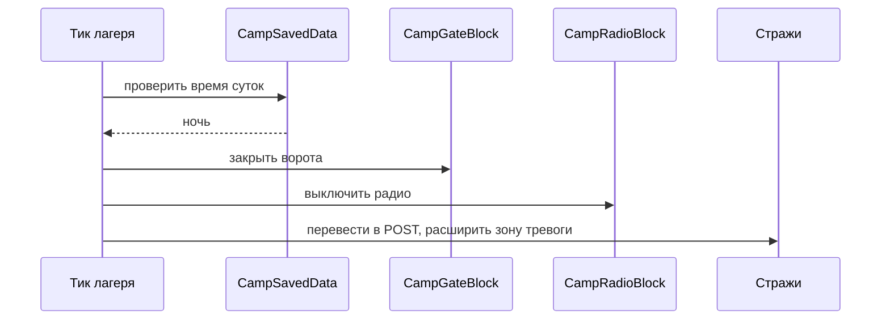
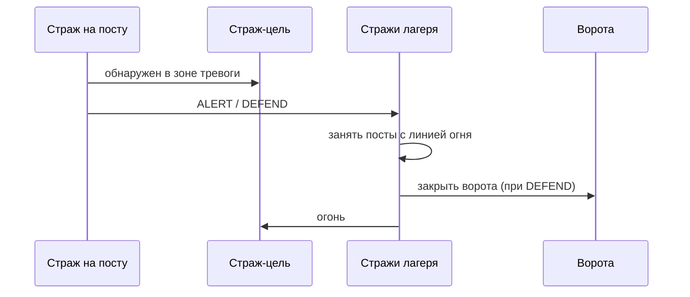

# DESIGN_CAMP_SYSTEM.md — Система лагерей SurvivalPoints

> Детальное техническое задание и план реализации системы лагерей.
> Общий обзор замысла мода — в [`PROJECT_VISION.md`](../Architecture/PROJECT_VISION.md).
> Среда, архитектура ИИ и правила работы — в [`AI_CONTEXT.md`](../../../src/main/java/com/phian404/survivalpoints/AI_CONTEXT.md).
> Социально-экономический слой (глава, торговля, репутация, задания, ферма, роли оружия, генерация лагеря) —
> в [`DESIGN_CAMP_SOCIAL.md`](DESIGN_CAMP_SOCIAL.md).
>
> **Статус документа:** проектный (код не написан). Решения владельца зафиксированы
> в [`DESIGN_CAMP_SOCIAL.md`](DESIGN_CAMP_SOCIAL.md) §0, открытые вопросы — там же §11.
> **Примечание (2026-11-22):** разделы, ссылающиеся на `CampFenceBlock`/`CampFencePostBlock`/`CampBarbedWireBlock` (старый YIIIY-периметр), устарели. Актуальная система ограждений — модульная (`post` + `*_section` + 6 ржавых + `camp_gate`); см. `.roo/plans/Fences/SurvivalPoints_Fences_v1.1.7-final.md`.

---

## 1. Видение

Постапокалипсис. Где-то в мире выжившие строят **лагерь** — укреплённую стоянку с забором, воротами, ловушками, наблюдательными вышками, теплицей и складом. У лагеря есть **глава**, который распоряжается ресурсами. По радио вышка лагерь зовёт других выживших. Охраняют лагерь **стражи** — они стоят на постах, ночью закрывают ворота, с вышки отстреливают подходящих врагов и не поднимают шум на весь мир.

Ключевые слова: **автономность**, **обособленность**, **скрытность**, **ночной режим**, **выживание**.

### 1.1 Что лагерь НЕ делает

- Не принадлежит игроку. Игрок — внешний наблюдатель, а не владелец (личные лагеря — отдельная механика, см. §11.3).
- Не превращается в «свою базу с кнопками»: игрок не строит стены, а наблюдает, торгует, помогает.
- Не шумит: стражи не стреляют по всему миру и не бегают по карте, привлекая внимание.

---

## 2. Дизайн-принципы

| # | Принцип | Следствие в коде |
|---|---|---|
| 1 | Лагерь — **материален** | Периметр, ворота, вышки — реальные блоки мира, а не абстракция |
| 2 | Лагерь **не принадлежит** игроку | Нет `OwnerId`; связь только «лагерь ↔ стражи» через `campId` |
| 3 | **Скрытность** | Поиск цели ограничен зоной тревоги; на посту — безмолвный |
| 4 | **Ночной режим** | Поведение лагеря зависит от времени суток |
| 5 | **Автономность** | Лагерь сам пополняет штат и сам производит еду |
| 6 | **Деградация** | Разрушенный забор → провал в безопасности, лагерь чинит его |
| 7 | **Отсутствие привязки к игроку** | Данные лагеря живут в мире, не в данных игрока |
| 8 | **Постепенность** | Каждый этап даёт играбельный результат сам по себе |

---

## 3. Модель лагеря

### 3.1 Рассмотренные варианты

| Вариант | Суть | Плюсы | Минусы | Вердикт |
|---|---|---|---|---|
| **A. Пост как зона охраны** | Один `BlockPos` + радиус, стражы просто патрулируют рядом | Минимум кода | Нет «лагеря» в понимании игрока, нечего показывать | Отклонён |
| **B. Материальный лагерь** | Реальные блоки: забор, ворота, вышки, ловушки, теплица, склад | Видно, можно разрушать, тактильно | Много кода: блоки, BE, рендер, взаимодействие | **Часть рекомендации** |
| **C. Лагерь + посты** | Лагерь = данные (`SavedData`) + набор постов, стражы распределены по постам | Хорошо ложится на существующий ИИ, легко расширять | Посты виртуальные — постройку не видно | **Часть рекомендации** |
| **D. Формальная территория** | Ничего не строится, только координаты и эффекты | Быстро | Нет материальности, не выглядит как лагерь | Отклонён |
| **E. Гибрид B + C** | Забор/ворота/вышки/склад — блоки; посты, ловушки, ферма, штат — данные | Материально + гибко | Две подсистемы | **Рекомендация** |

### 3.2 Рекомендация — вариант E (гибрид)

**Материальная часть** (блоки мира, разрушаема и видимая):

| Элемент | Реализация | Зачем |
|---|---|---|
| Забор | Кастомный `CampFenceBlock` (наследник `IronBarsBlock`) + колючая проволока `CampBarbedWireBlock` над ним | Периметр, стены, укрытие |
| Ворота | `CampGateBlock` + `BlockEntity` (открыто/закрыто, авто-закрытие ночью) | Единственный вход, днём открыты |
| Вышка | `CampWatchtowerBlock` + `BlockEntity` (высота, тип поста) | Обзор 360°, повышенный бонус |
| Склад | `CampStorageBlock` + `BlockEntity` (слоты ресурсов лагеря) | Сундук-хранилище: еда/патроны/материалы |
| Радио вышка (**якорь лагеря**) | `CampRadioBlock` + `BlockEntity` | «Сердце» лагеря: якорь, привязка `SavedData`, вербовка, призыв выживших |
| Связь между лагерями | данные `CampSavedData` | Отношения и торговля — не отдельный блок |
| Ловушка | `CampTrapBlock` + `BlockEntity` (тип: шипы/петля/сигнал) | Урон/замедление врагу, тихо для своих |

**Данные** (`CampSavedData`): центр, радиус, список постов, привязки стражей, склад (ресурсы), ферма, режим, таймеры, репутация.

**Почему гибрид.** Блоки дают материальность и «автономный вид» лагеря (то, что просил владелец) и бесплатно получают рендер, разрушаемость, взаимодействие, сохранение в чанке. Данные дают то, что блоками неудобно: привязку стража к посту, распределение штата, таймеры пополнения, репутацию между лагерями. Если сделать всё блоками — распухает `BlockEntity` лагеря и теряется доступ к данным из тика лагеря. Если всё в данных — лагерь нельзя построить и увидеть.

**Допущение (пересмотрено):** блоки лагеря должны читаться как единая «укреплённая стоянка выживших» —
тёмное дерево + металл/ржавчина, единая палитра, кастомные текстуры. Приоритет — цельный узнаваемый
силуэт при разумной цене арта (решение владельца, см. [`WAVE2_PLAN.md`](../_archive/WAVE2_PLAN.md) «Решения владельца»).

---

## 4. Структура лагеря (пространственная)

### 4.1 Компоненты



### 4.2 Геометрия

- **Периметр** — произвольный (не обязан быть прямоугольным). Радиус по умолчанию `CAMP_DEFAULT_RADIUS = 24` блока.
- **Ворота** — 1–2 штуки, задаются при создании лагеря (или находятся автопоиском «узкого места» на периметре).
- **Вышки** — размещаются на угловых/смотровых точках периметра; их `BlockPos` = **посты** типа `TOWER`.
- **Посты у забора** — виртуальные точки, вычисляются по периметру: N точек, равномерно распределённых, каждая с направлением обзора **наружу** (от центра лагеря).
- **Ловушки** — привязаны к воротам: 2–4 на подходах.

### 4.3 Типы постов

| Тип | Где | Обзор | Бонус | Особенность |
|---|---|---|---|---|
| `TOWER` | На вышке | 360° | +30% к дальности стрельбы, +20% к урону | Не спускается, пока не объявлена тревога |
| `WALL` | У забора | 120° сектор наружу | — | Следит за сектором, поворачивается внутри него |
| `GATE` | У ворот | 180° наружу | — | Основная точка конфликта |
| `PATROL` | Бродит по периметру | 360° | — | Мобильный пост: обход маршрутом |

---

## 5. Поведение стража в лагере

### 5.1 Новые состояния

Текущий автомат ([`BaseGuardianEntity`](../../../src/main/java/com/phian404/survivalpoints/entity/BaseGuardianEntity.java:155)) имеет `IDLE / RANGED / MELEE / PANIC`.

> **Статус решения: УТВЕРЖДЕНО владельцем (вариант A).** См.
> [`GUARDIAN_STATE_DECISION.md`](../Combat/GUARDIAN_STATE_DECISION.md). Принято: боевой автомат
> `GuardianState` **удаляется** (боевое поведение — прерогатива голов `GoalSelector`), а лагерные
> состояния ниже реализуются **отдельными голы** (`GuardianPostGoal`, `GuardianPatrolGoal`,
> `GuardianFarmGoal`, `GuardianAlertGoal`, `GuardianDefendGoal` — см. §14). `GuardianState` лагерными
> состояниями **не расширяем**; ночь/тревога/привязка живут в данных лагеря
> (`CampRecord.mode`, `CampPost`, `CampId`/`CampPostId`). Таблица ниже описывает **требуемое
> поведение** и источник данных для каждого состояния.

Для лагеря требуются состояния:

| Состояние | Условие | Поведение |
|---|---|---|
| `POST` | Есть лагерь, нет угрозы, страж привязан к посту | Стоит на посту, смотрит в сектор, молчит |
| `PATROL` | Тип поста `PATROL` | Обходит периметр по маршруту, останавливается в точках |
| `FARM` | Смена «рабочего» в дневное время | Работает на ферме: сеет/собирает пшеницу, относит в склад |
| `ALERT` | Враг в зоне тревоги, но вне лагеря | Занимает ближайший пост с линией огня, открывает огонь |
| `DEFEND` | Враг внутри периметра | Все стражи лагеря переходят в бой, ворота закрываются |
| `RALLY` | Кто-то позвал на помощь | Бежит на точку вызова (существующее поведение) |
| `PANIC` | HP < 30% | Отход, зов союзников (существующее поведение) |

### 5.2 Ключевое изменение — рубеж от поста, а не от врага

**Текущая проблема.** Точка отхода считается от позиции врага (`fleePoint = target.position() + away.scale(8)`), поэтому страж отходит **вместе** с врагом; плюс флаг `reachedStandoff` живёт в голе и сбрасывается при перезапуске гола (смена состояния `MELEE ↔ RANGED ↔ PANIC`) → качели «приблизился — отошёл — приблизился».

**Новое правило.** Рубеж — это **пост** (или безопасная точка лагеря). Страж:
1. дошёл до рубежа один раз → `standoffReached = true` (флаг живёт в **сущности**, а не в голе);
2. дальше только отходит **к посту**, не приближаясь к врагу;
3. при смене цели/состояния флаг **не** сбрасывается — сбрасывается только при смене лагеря, смерти цели или явном приказе;
4. если враг зашёл в лагерь — рубеж отменяется, страж идёт в бой.

Промежуточный фикс (этап 0, до появления лагерей) — считать отход от **собственной позиции в момент начала боя**, а не от врага.

### 5.3 Приоритеты целей

| Приоритет | Что |
|---|---|
| 1 | Враг **внутри** лагеря → `DEFEND` |
| 2 | Враг в зоне тревоги → `ALERT`, занять пост с линией огня |
| 3 | Враг вне зоны тревоги → **игнорировать** (это и есть «не привлекать внимание») |

### 5.4 Скрытность

- Поиск цели идёт **только** в зоне тревоги лагеря (если лагерь есть) — иначе поведение как сейчас.
- На посту (`POST`/`PATROL`) страж не преследует цель за пределы радиуса поста.
- Страж на посту **не издаёт** боевых звуков и не бегает (опционально `setSilent(true)` — TBD).
- Стражи **не стреляют** по целям без линии огня и не палят по площади.
- Днём, вне тревоги, страж может стоять неподвижно — это «не заметен».

---

## 6. Ночной режим

Переключается по `ServerLevel#getDayTime()` (ночь = `!level.isDay()` или `dayTime % 24000 > 13000` — TBD точные границы).

| Элемент | День | Ночь |
|---|---|---|
| Ворота | Открыты | Закрыты (автоматически) |
| Ловушки | Выключены (не мешают своим) | Активны |
| Стражи | `POST`/`PATROL`/`FARM` | Только `POST`, больше в вышках |
| Радио вышка | Работает (зовёт выживших) | Выключена |
| Ферма | Поливается, собирается | Не поливается |
| Зона тревоги | `CAMP_ALERT_RADIUS_DAY` (напр. 40) | `CAMP_ALERT_RADIUS_NIGHT` (напр. 64) |
| Глава лагеря | У склада, выдаёт задания | Спит/укрывается |
| Освещение | — | Факелы на вышках (опционально) |

Реализация: `CampSavedData#isNight` + тик лагеря (раз в 20 тиков) → переключение состояний ворот, ловушек, радио; стражи читают режим из `SavedData` (или получают флаг через `SynchedEntityData`).

---

## 7. Штат, найм и снабжение

### 7.1 Параметры (настраиваемые, по требованию владельца)

| Параметр | Значение | Смысл |
|---|---|---|
| `CAMP_STAFF_CHECK_INTERVAL` | `6000` тиков (5 мин) | Как часто проверять штат |
| `CAMP_MIN_GUARDIANS` | `8` | Минимум стражей в лагере |
| `CAMP_MAX_GUARDIANS` | `16` | Максимум (TBD) |
| `CAMP_ALERT_RADIUS_DAY` | `40` | Зона тревоги днём |
| `CAMP_ALERT_RADIUS_NIGHT` | `64` | Зона тревоги ночью |
| `CAMP_POST_COUNT` | `8` | Сколько постов по умолчанию |

Все — в [`GuardianTuning`](../../../src/main/java/com/phian404/survivalpoints/init/GuardianTuning.java) или в отдельный `CampTuning` (рекомендуется отдельный, чтобы не раздувать `GuardianTuning`).

### 7.2 Алгоритм пополнения



### 7.3 Источники пополнения (по убыванию приоритета)

1. **Радио вышка** — объявляет лагерь; в радиусе появляется «выживший»-кандидат, идёт в лагерь, вербуется.
2. **Вербовка игроком** — ПКМ по маяку с определённым предметом (стак/арбалет/метка) → страж рядом переходит в лагерь. Это «личный лагерь» в минимальном виде.
3. **Свободные стражи поблизости** — страж без лагеря в радиусе `CAMP_RECRUIT_RADIUS` (напр. 48) может быть принят, если в лагере есть место.
4. **Ручная команда** — `/sp_camp add <id>` (для отладки).

### 7.4 Снабжение

- **Еда.** Ферма выращивает пшеницу → переработка в хлеб (рецепт за лагерным верстаком или авто) → склад → [`GuardianEatBreadGoal`](../../../src/main/java/com/phian404/survivalpoints/entity/ai/GuardianEatBreadGoal.java) берёт хлеб из склада лагеря, а не из мира.
- **Боеприпасы/оружие.** Склад хранит арбалеты/стрелы/патроны; при найме стражу выдаётся снаряжение из склада.
- **Расходники.** Ловушки и вышки могут требовать ресурсы (редстоун/железо) — расход из склада.

---

## 8. Экономика лагеря: теплица и ферма

### 8.1 Теплица

Физически — ванильные блоки (стекло + вода + грядки) **плюс** «зона фермы» в данных лагеря (радиус вокруг «теплицы»). Зона нужна, чтобы страж-«фермер» знал, где работать, и чтобы система могла привязать ферму к лагерю.

### 8.2 Цикл

1. Страж в состоянии `FARM` идёт в зону фермы.
2. Находит пустую грядку → сажает пшеницу (`WheatSeeds`).
3. Ждёт роста (проверка раз в N тиков) → собирает.
4. Несёт в склад лагеря → счётчик `Food += 1`.
5. При `Food >= 8` автопекарётся хлеб (`Food -= 8`, `Bread += 1`) — через рецепт или напрямую.

### 8.3 Теплица как «помогающая» механика

Ферма решает проблему «стражи голодают и едят хлеб из мира» — еда производится внутри лагеря, что подчёркивает автономность.

---

## 9. Глава лагеря

**Реализованная архитектура — [`plan.md`](../Entities/plan.md).** Лидер — обычный NPC с данными лидерства,
а не отдельный `EntityType`. Отдельный тип только ради лидерства не создаётся. Модель понятий
(тип сущности, профессия, навыки, назначение, лидерство) — в
[`NPC_CAMP_SIMULATION_DESIGN.md`](../Entities/NPC_CAMP_SIMULATION_DESIGN.md) §1.1.

| Аспект | Решение |
|---|---|
| Кто | Мирный NPC (`BaseSurvivorNpcEntity`) с данными лидерства; отдельный класс-сущность не нужен |
| Связь с лагерем | Постоянный `identityId`, а не runtime UUID сущности |
| Где | У склада / в центре лагеря |
| Что делает | Выдаёт задания, принимает пожертвования, открывает торговлю, решает, кого пустить |
| Интерфейс | Собственный экран управления лагерем (см. [`DESIGN_CAMP_SOCIAL.md`](DESIGN_CAMP_SOCIAL.md) §12.6) |
| Данные | Позиция/привязка лидера в `CampRecord`, репутация по игрокам, состояние заданий |
| Задания | Триплет: тип (убить мобов / собрать пшеницу / починить забор) + счётчик + награда (репутация, предметы) |

Связь с «личным лагерем»: репутация игрока в лагере определяет, может ли он вербовать стража и торговать.

---

## 10. Радио вышка

| Аспект | Решение |
|---|---|
| Блок | `CampRadioBlock` + `BlockEntity` |
| **Якорь** | Лагерь существует, пока стоит его радио вышка. Отдельного «маяка» нет — это экономит один блок и даёт смысловую связку «вышка = связь = призыв» |
| **Потолок** | Мировых лагерей — ограниченное число (точное значение не утверждено, в документах встречаются 3, 4 и «3–4»). **Личный лагерь — 1 на игрока** |
| Когда работает | Днём, если лагерь обеспечен «зарядом» (ресурс в инвентаре BE или редстоун-сигнал) |
| Что делает | Раз в `CAMP_RADIO_CALL_INTERVAL` (напр. раз в день) рассылает «объявление»: в радиусе `CAMP_RADIO_RANGE` (напр. 128) спавнится кандидат-выживший, идущий в лагерь |
| Ночью | Выключена |
| Уничтожена | Лагерь распадается: посты и привязки исчезают, склад выпадает в сундук, стражи теряют лагерь |
| Расширение (будущее) | Объявление с торговым предложением для соседних лагерей → торговые отношения (§11) |

---

## 11. Отношения между лагерями и личные лагеря

### 11.1 Статус отношений

`CampRelation`: `NEUTRAL` → `FRIENDLY` → `HOSTILE`.
Хранится в `CampSavedData` (карта `UUID → {relation, trade offers}`).

| Событие | Влияние |
|---|---|
| Обмен ресурсами через радио | `NEUTRAL → FRIENDLY` |
| Нападение на лагерь | `FRIENDLY → HOSTILE` |
| Общая атака на врага | `NEUTRAL → FRIENDLY` |

### 11.2 Торговля (задел)

Обмен: пшеница/хлеб ↔ патроны/оружие/ресурсы. Транспорт — «сообщение по радио»: в лагере-получателе появляется груз (сундук/аванпост), в лагере-отправителе списывается ресурс.

### 11.3 Личный лагерь игрока

- Отдельный лагерь с `ownerUuid` (в отличие от мировых).
- Создаётся ПКМ по маяку с «меткой лагеря» (предмет-метка).
- Владелец может вербовать стражей, снимать/ставить блоки, забирать ресурсы.
- Основной лагерь (мировой) — **не** имеет владельца, ресурсы не выносятся.

---

## 12. Интеграция с TacZ (огнестрел)

### 12.1 Цель

Стражи на постах могут использовать огнестрельное оружие (пистолеты/винтовки), если мод TacZ установлен.

### 12.2 Архитектура

Не зашивать тип оружия в [`BaseGuardianEntity`](../../../src/main/java/com/phian404/survivalpoints/entity/BaseGuardianEntity.java). Ввести слой:



- `WeaponProfile` — интерфейс: урон, скорость, кулдаун, тип снаряда, звук, дальность, `isRanged()`.
- `TaczFirearmProfile` — реализация, загружается **только** если `ModList.get().isLoaded("tacz")`.
- В `mods.toml` — зависимость `tacz` с `ordering="AFTER"`, `mandatory=false` (soft-dependency), чтобы мод работал и без TacZ.

### 12.3 Боеприпасы

Патроны — ресурс склада. Страж стреляет, пока есть патроны; при отсутствии — переходит на арбалет. Это даёт лагерю экономику: «радио вышка → выжившие → патроны → выжившие» — цикл.

### 12.4 Сложность

Высокая: требует знания API TacZ (спавн пули, настройка стрельбы, звук). **Рекомендация — отложить на последний этап**, сначала закончить лагерь на арбалете. Абстракция `WeaponProvider` закладывается заранее, чтобы потом не переписывать.

---

## 13. Данные и хранение

### 13.1 Сравнение вариантов хранения

| Вариант | Плюсы | Минусы | Вердикт |
|---|---|---|---|
| `SavedData` (Forge, per-dimension) | Стандартный путь, не теряется, лёгкая, переживает перезапуск, доступна из тика | Нет «живого» объекта с тиком — нужен собственный тик | **Рекомендация** |
| Сущность-«лагерь» | Есть тик, `SynchedEntityData`, визуализация | Лишняя сущность, клиентский трафик, течёт при выгрузке чанков | Отклонён (данные вместо неё) |
| Статика в классе | Просто | Теряется при выгрузке, не работает с мультисервером | Отклонён |
| Данные игрока | Привычно | Лагерь не принадлежит игроку; ломается при смене игрока | Отклонён |

### 13.2 Состав `CampRecord`

**Фактически в коде** ([`CampRecord.java`](../../../src/main/java/com/phian404/survivalpoints/camp/CampRecord.java)):

```
CampSavedData (per-dimension)
└── camps: Map<UUID, CampRecord>
    ├── id, name, center, radius
    ├── owner (null для мировых лагерей)
    ├── anchor: BlockPos            // позиция радио-вышки
    ├── posts: List<CampPost>
    ├── guardianPosts: Map<UUID, UUID>   // guardId -> postId
    ├── relations: Map<UUID, CampRelation>
    ├── resources: food, bread, ammo, weapons, materials
    ├── mode: night, closed, alertRadius
    └── timers: staffCheckTimer, radioCallTimer
```

**Планируемые поля (в коде отсутствуют, целевая модель):**

```
    ├── beaconPos, gatePos[], towerPos[], trapPos[], farmCenter, storagePos, leaderPos
    └── timers: farmTick
```

Поля из этого блока не реализованы: блоков лагеря, кроме радио-вышки, пока нет,
а `leaderPos` не добавлен в сериализацию. Добавлять их следует вместе с реализацией
соответствующих механик, а не заранее.

### 13.3 Привязка стража к лагерю

Поля `campId` (UUID) и `postId` (UUID) живут в общей базе
[`BaseSurvivorEntity`](../../../src/main/java/com/phian404/survivalpoints/entity/BaseSurvivorEntity.java),
а не в `BaseGuardianEntity`: привязка нужна любому NPC лагеря, не только стражу.
NBT-теги: `CampId`, `CampPostId`.

Связь «лагерь ↔ NPC» должна опираться на постоянный `identityId`
([`BaseSurvivorEntity#getIdentityId()`](../../../src/main/java/com/phian404/survivalpoints/entity/BaseSurvivorEntity.java:76)),
а не на runtime UUID сущности — см. [`plan.md`](../Entities/plan.md).

### 13.4 Тик лагеря

Отдельный тик не нужен: лагеря тикаются **раз в 20 тиков** из общего обработчика (например, `ServerTickEvent` в [`ModEntityEvents`](../../../src/main/java/com/phian404/survivalpoints/init/ModEntityEvents.java) или новом `CampEvents`). Проверка интервала пополнения — по счётчику в `SavedData`.

---

## 14. Структура классов (предлагаемая)

```
com.phian404.survivalpoints
├── camp/
│   ├── CampSavedData.java          — per-dimension хранилище лагерей
│   ├── CampRecord.java             — данные одного лагеря (сериализуемые)
│   ├── CampPost.java               — пост: тип, позиция, направление
│   ├── CampRelation.java           — отношения между лагерями
│   ├── CampManager.java            — поиск/создание лагеря, тик, пополнение штата
│   ├── CampTuning.java             — константы лагерной системы
│   ├── block/
│   │   ├── CampBeaconBlock.java    — маяк лагеря
│   │   ├── CampFenceBlock.java     — забор
│   │   ├── CampGateBlock.java      — ворота
│   │   ├── CampWatchtowerBlock.java— вышка
│   │   ├── CampStorageBlock.java   — склад
│   │   ├── CampTrapBlock.java      — ловушка
│   │   └── CampRadioBlock.java     — радио вышка
│   ├── blockentity/
│   │   ├── CampGateBlockEntity.java
│   │   ├── CampWatchtowerBlockEntity.java
│   │   ├── CampStorageBlockEntity.java
│   │   ├── CampTrapBlockEntity.java
│   │   └── CampRadioBlockEntity.java
│   ├── (лидер лагеря — данные обычного NPC, отдельный класс не нужен;
│   │    см. plan.md и NPC_CAMP_SIMULATION_DESIGN.md §1.1)
│   └── (кандидат по радио — обычный NPC, создаётся через RoleAssignmentService)
├── entity/ai/
│   ├── GuardianPostGoal.java       — NEW: стоять на посту
│   ├── GuardianPatrolGoal.java     — NEW: обход периметра
│   ├── GuardianFarmGoal.java       — NEW: работа на ферме
│   ├── GuardianAlertGoal.java      — NEW: тревога по внешнему врагу
│   └── GuardianDefendGoal.java     — NEW: оборона лагеря
└── weapon/                         — NEW: слой оружия
    ├── WeaponProfile.java
    ├── BowProfile.java
    ├── CrossbowProfile.java
    ├── MeleeProfile.java
    └── (позже) TaczFirearmProfile.java
```

---

## 15. События и точки расширения

| Событие / точка | Назначение |
|---|---|
| `ServerTickEvent` (раз в 20) | Тик лагерей: режим, пополнение штата, ферма, радио |
| `EntityJoinLevelEvent` | Страж вошёл в лагерь → попытка привязки к посту |
| `LivingDeathEvent` | Смерть стража → освободить пост, снять с учёта |
| `BlockEvent.BreakEvent` | Разрушен забор/ворота → деградация лагеря |
| `BlockEvent.PlaceEvent` | Установка блока лагеря рядом с маяком → регистрация элемента |
| `RightClickBlock` | ПКМ по маяку (вербовка), по воротам (открыть/закрыть), по складу |
| `PlayerInteract` | Торговля с главой лагеря |
| `CampTuning` | Единая точка настройки всех порогов |

---

## 16. Последовательности

### 16.1 Создание лагеря



### 16.2 Ночь



### 16.3 Тревога



---

## 17. Список файлов (будущих)

**Новые — блоки и BE:**
`camp/block/CampFenceBlock.java`, `CampGateBlock.java`, `CampWatchtowerBlock.java`, `CampStorageBlock.java`, `CampTrapBlock.java`, `CampRadioBlock.java` (✅ реализован), `camp/blockentity/*BlockEntity.java`, их `BlockItem`, регистрация в [`ModBlocks`](../../../src/main/java/com/phian404/survivalpoints/init/ModBlocks.java).

> Отдельного `CampBeaconBlock` **не планируется**: якорь лагеря — радио-вышка (§10).

**Новые — данные:**
`camp/CampSavedData.java`, `camp/CampRecord.java`, `camp/CampPost.java`, `camp/CampRelation.java`, `camp/CampManager.java`, `camp/CampTuning.java`.

**Новые — ИИ:**
`entity/ai/GuardianPostGoal.java`, `GuardianPatrolGoal.java`, `GuardianFarmGoal.java`, `GuardianAlertGoal.java`, `GuardianDefendGoal.java`.

**Новые — существа:**
Отдельные классы сущностей для лидера и кандидата по радио **не создаются**: оба — обычные NPC
из общей базы, создаваемые через `RoleAssignmentService` ([`plan.md`](../Entities/plan.md)).

**Новые — слой оружия:**
`weapon/WeaponProfile.java`, `BowProfile.java`, `CrossbowProfile.java`, `MeleeProfile.java`.

**Изменяемые:**
`BaseGuardianEntity.java` (campId/postId/standoff-флаги/состояния), `GuardianTuning.java` или новый `CampTuning`, `init/ModEntities.java`, `init/ModBlocks.java` (новый), `SurvivalPointsMod.java`, `init/ModEntityEvents.java` (тик лагеря), `init/GuardDebugCommand.java` (`/sp_camp` — новая команда), `resources/META-INF/mods.toml` (soft-dep на TacZ), `resources/assets/survivalpoints/lang/*` (переводы), `resources/assets/survivalpoints/blockstates/*`, `models/block/*`, `textures/block/*`.

---

## 18. Поэтапный план

> **Канонический порядок волн и приоритеты — только [`ROADMAP.md`](../Roadmap/ROADMAP.md) §2.**
> Нумерация «этапов» ниже — **не канон**: это детализация базовой части лагеря,
> сохранённая ради критериев готовности. При расхождении номеров приоритет у `ROADMAP.md`.

### Этап 0 — Убрать остаточные качели (без лагерей)
- Перенести `reachedStandoff` из гола в сущность.
- Точка отхода — от **собственной позиции**, а не от врага.
- Сброс флага только при смерти цели / смене лагеря.
- **Критерий:** страж пришёл на рубеж один раз и больше не сближается, даже после ближнего боя.

### Этап 1 — Каркас данных
- `CampTuning`, `CampRecord`, `CampPost`, `CampSavedData`, `CampManager`.
- Создание лагеря через команду `/sp_camp create` (без блоков) — чтобы проверить данные раньше графики.
- **Критерий:** лагерь создаётся, переживает перезапуск мира, виден в `/sp_camp`.

### Этап 2 — Привязка стражей и посты
- `campId`/`postId` в сущности + NBT.
- `GuardianPostGoal` (стойка на посту с сектором обзора).
- Распределение стражей по постам.
- **Критерий:** страж без лагеря ведёт себя как раньше; страж в лагере стоит на посту и следит за сектором.

### Этап 3 — Материальная часть
- Блоки: маяк, забор, ворота, вышка, склад.
- Регистрация, модели, тонировка.
- **Критерий:** лагерь выглядит как укреплённая стоянка; ворота кликаются и открываются.

### Этап 4 — Зона тревоги, ALERT/DEFEND, ночной режим
- Зона тревоги, выбор поста с линией огня, закрытие ворот ночью, `isNight` в `CampSavedData`.
- **Критерий:** враг за периметром игнорируется; враг внутри — лагерь закрывается и стреляет.

### Этап 5 — Штат и найм
- Таймеры `CAMP_STAFF_CHECK_INTERVAL` / `CAMP_MIN_GUARDIANS`, вербовка, `/sp_camp add`.
- **Критерий:** при нехватке стражей лагерь через 5 минут набирает недостающих.

### Этап 6 — Радио вышка, выжившие, глава лагеря
- Блок радио, кандидат-выживший как обычный NPC, лидер как NPC с данными лидерства, базовые задания.
- **Критерий:** выживший появляется, идёт в лагерь, становится стражем.

### Этап 7 — Ферма, склад, экономика
- `GuardianFarmGoal`, `FARM`-состояние, переработка пшеницы в хлеб, снабжение стражей.
- **Критерий:** лагерь сам производит хлеб и кормит стражей.

### Этап 8 — Ловушки, вышки-бонусы, разрушаемость
- `CampTrapBlock`, бонус вышки, деградация при разрушении забора, починка.
- **Критерий:** враг, пролезший через пролом, ловится ловушкой; вышка даёт бонус.

### Этап 9 — Отношения между лагерями и торговля
- `CampRelation`, обмен по радио, репутация.
- **Критерий:** два лагеря договариваются о trade и обмениваются ресурсами.

### Этап 10 — TacZ (огнестрел)
- `WeaponProvider`, `TaczFirearmProfile`, патроны в складе, soft-dep.
- **Критерий:** с установленным TacZ страж стреляет из огнестрела; без TacZ мод работает как раньше.

### Этап 11 — Личный лагерь игрока
- `ownerUuid`, метка лагеря, вербовка, доступ к ресурсам.
- **Критерий:** игрок может создать личный лагерь и завести в него стражей.

---

## 19. Критерии готовности системы (финальные)

1. Лагерь виден в мире как укреплённая стоянка и переживает перезапуск.
2. Стражи стоят на постах, не привлекают внимания и не стреляют по всему миру.
3. Враг за периметром игнорируется; враг внутри — вызывает оборону.
4. Ночью ворота закрыты, ловушки активны, радио выключено.
5. При нехватке стражей лагерь пополняется в течение `CAMP_STAFF_CHECK_INTERVAL`.
6. Лагерь производит хлеб и кормит стражей.
7. Радио вышка вызывает выжившего, он приходит и вербуется.
8. Есть глава лагеря с заданиями.
9. Мод работает без TacZ и добавляет огнестрел с ним.
10. Есть `/sp_camp` для диагностики (состояние, штат, посты, ресурсы).

---

## 20. Альтернативы и их цена

| Альтернатива | Что упрощает | Что усложняет |
|---|---|---|
| Всё в `SavedData`, без блоков | Один слой данных, быстрый прототип | Нет материальности, игрок не видит лагерь |
| Всё блоками | Естественность, разрушаемость «из коробки» | `BlockEntity` лагеря разрастается, сложно менять баланс |
| Лагерь = существо-мутант (например, перевёрнутый зомби-«глава») | Очень «постапокалипсис», необычно | Сложная анимация, спавн, ИИ, баланс; отвлекает от основной задачи |
| Посты = только вышки (без постов у забора) | Меньше сущностей, проще | Мало стрелков, периметр мёртвый |
| Штат = фиксированное число (не «минимум 8») | Проще, предсказуемо | Нет «пополнения», теряется требование владельца |
| Радио = мгновенный спавн стража | Проще | Нет «выжившего» как персонажа, теряется атмосфера |

---

## 21. Решения, требующие выбора владельца

> **Часть решений уже принята** — см. [`DESIGN_CAMP_SOCIAL.md`](DESIGN_CAMP_SOCIAL.md) §0 (зафиксировано)
> и §11 (закрытые вопросы). Список ниже — по **базовой** части лагеря.
>
> **Закрыто после сверки:** п.7 (ночь — по `isNight()`), п.8 (ферма без перегрузки), п.9 (задания
> входят в волну 6), п.10 (торговля между лагерями — задел, `CampRelation` остаётся), п.11 (TacZ
> отложен, soft-dep), п.12 (скрытность — см. §5.4). Остаются открытыми пп.1–6.

1. **Формат лагеря.** Гибрид (блоки + данные, рекомендация §3.2) или полностью виртуальный лагерь без построек?
2. **Кто создаёт лагерь.** Только игрок (ПКМ по маяку) — или лагерь может возникнуть сам (например, рядом с разрушенным поселком, по сюжету)?
3. **Владение.** Подтверждаем: мировые лагеря без владельца, личные — отдельная механика. Нужно ли вообще делать личные лагеря в первой версии?
4. **Размер.** Радиус 24 блока (≈ 6×6 секций забора) — нормально? Сколько постов и вышек считать «нормальным» лагерем?
5. **Штат.** `MIN = 8` — это на лагерь любого размера или на «большой»? Нужен ли `MAX`, и какой?
6. **Период проверки.** 5 минут (6000 тиков) — оставить? Или проверять каждый тик с интервалом «набора», чтобы пополнение происходило быстрее?
7. **Ночь.** Границы ночи: по `isNight()` (в 1.20.1 — от заката до рассвета) или фиксированные тики? Должны ли ворота закрываться вручную игроком или только автоматически?
8. **Ферма.** Пшеница → хлеб: автоматическая выпечка или рецепт на верстаке в лагере? Кто печёт — страж-«фермер» или глава?
9. **Задания главы.** Нужны ли задания с наградами в первой версии, или глава только торгует и раздаёт указания?
10. **Отношения.** Торговля между лагерями — в объём первой версии или строго в задел? Если в задел, оставляем ли заготовку `CampRelation` в данных с первого дня (да, рекомендую)?
11. **TacZ.** Подтверждаем отложенный старт (этап 10) и soft-dependency? Какой именно калибр — пистолеты, винтовки, дробовики?
12. **Скрытность.** Отключать ли ambient-звуки и шаги стражей на посту? И как стражи выглядят — без свечения/эффектов, чтобы не привлекать внимание?

---

## 22. Связанные документы

- [`PROJECT_VISION.md`](../Architecture/PROJECT_VISION.md) — общий замысел мода, среда, дорожная карта.
- [`ROADMAP.md`](../Roadmap/ROADMAP.md) — канон порядка волн и приоритетов.
- [`plan.md`](../Entities/plan.md) — канон архитектуры NPC и смены роли.
- [`DESIGN_CAMP_SOCIAL.md`](DESIGN_CAMP_SOCIAL.md) — социально-экономический слой лагеря.
- [`NPC_CAMP_SIMULATION_DESIGN.md`](../Entities/NPC_CAMP_SIMULATION_DESIGN.md) — модель NPC, навыки, симуляция.
- [`RADIO_TOWER_DETAIL.md`](RADIO_TOWER_DETAIL.md) — детали радио-вышки.
- [`AI_CONTEXT.md`](../../../src/main/java/com/phian404/survivalpoints/AI_CONTEXT.md) — текущее состояние кода, архитектура ИИ, правила работы, диагностика.
