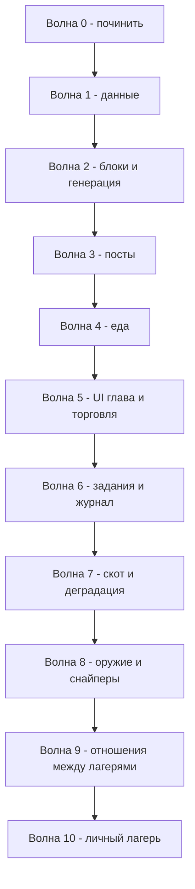

# ROADMAP.md — Глобальный план SurvivalPoints

> Порядок реализации, приоритеты, разбор сторонних зависимостей, политика бэкапов и
> каталог «иллюзий» — упрощений, дающих 80% восприятия при 20% кода.
> Социально-экономический слой лагеря (глава, торговля, репутация, задания, ферма, оружие) —
> в [`DESIGN_CAMP_SOCIAL.md`](../Camp/DESIGN_CAMP_SOCIAL.md).
>
> Связанные документы: [`PROJECT_VISION.md`](../Architecture/PROJECT_VISION.md) · [`DESIGN_CAMP_SYSTEM.md`](../Camp/DESIGN_CAMP_SYSTEM.md) · [`AI_CONTEXT.md`](../../../src/main/java/com/phian404/survivalpoints/AI_CONTEXT.md)

---

## 1. Правило приоритизации

Механика попадает в работу, если проходит три фильтра:

| Фильтр | Вопрос | Порог |
|---|---|---|
| **Восприятие** | Игрок заметит это за 10 секунд после установки? | Если нет — в конец очереди |
| **Польза** | Связана ли с ядром мода (лагерь + стражи)? | Если нет — в задел |
| **Цена** | Сколько кода и новых сущностей/блоков? | >250 строк или >1 новая сущность → дробить на 2 задачи |

**Следствие:** «красивая, но незаметная» механика (например, торговля между лагерями) всегда проигрывает заметной (стражи на постах, ворота ночью, еда в лагере).

**Дополнительное правило — «правило одного экрана»:** каждая новая команда, блок и режим должны объясняться одной строкой в `/sp_camp`.

---

## 2. Сводный план по волнам

Порядок = (ценность × заметность) ÷ цена, с учётом зависимостей.

| Волна | Содержание | Новых блоков | Новых сущностей | Почему сейчас |
|---|---|---|---|---|
| **0. Чиним сломанное** | Остаточные качели «приблизился — отошёл» | 0 | 0 | Единственная известная регрессия; ломает восприятие «турель» и будущий рубеж |
| **1. Лагерь как данные** | `CampTuning`, `CampRecord`, `CampPost`, `CampSavedData`, `CampManager`, `/sp_camp` | 0 | 0 | Фундамент; ошибки в данных дешевле, чем в блоках |
| **2. Лагерь как место** | **Радио вышка (якорь)**, забор + колючая проволока, ворота + генерация по ASCII-блюпринтам | 4 | 0 | Лагерь должен быть **виден**; иначе всё остальное не ощущается |
| **3. Стражи на постах** | `campId`/`postId`, `GuardianPostGoal`, распределение, зона тревоги, `ALERT`/`DEFEND`, ночь, вышка | 1 | 0 | Сердце: лагерь без постов — декорация |
| **4. Жизнеобеспечение** | Склад, фермер-житель, грузчик, хлеб, кормление стражей | 1 | 0 | Стражи перестают «пожирать» еду из мира |
| **5. UI-волна I** | NPC лагеря (глава) + UI, диалог, торговля, репутация | 0 | 0 | Лагерь начинает общаться с игроком |
| **6. UI-волна II** | Задания, доска объявлений, журнал + хоткей | 1 | 0 | Игрок получает цель за пределами лагеря |
| **7. Скот и деградация** | Поголовье, починка, последствия разрушений | 0 | 0 | Лагерь становится живым и уязвимым |
| **8. Оружие** | Роли `SCRAP/STANDARD/LEADER` + TacZ-снайперы на вышках | 0 | 0 | Только когда базовый лагерь устоит |
| **9. Отношения** | Торговля между лагерями, распространение репутации | 0 | 0 | Мир перестаёт быть пустым |
| **10. Личный лагерь** | Потолок 1 на игрока, якорь = радио вышка | 0 | 0 | По остаточному бюджету |

> **Статус:** волны **0** (починка качелей) и **1** (каркас данных лагеря) — выполнены,
> детали в [`AI_CONTEXT.md`](../../../src/main/java/com/phian404/survivalpoints/AI_CONTEXT.md) §5.
> **Git:** коммит делается **на границе волны**, а не после каждой правки (решение владельца):
> внутри волны история не засоряется «полу-фиксами», но откат по волне всегда возможен.
> **Волна 2 разбита на под-волны 2.1–2.3 (2.1 якорь+генерация, 2.2 забор+проволока+ворота,
> 2.3 вышка+склад) с проверкой в игре** — [`WAVE2_PLAN.md`](../Camp/WAVE2_PLAN.md).
> **Под-волна 2.5 — электропериметр** (генератор, чёрный провод, урон при контакте): флаг
> живёт в данных лагеря, а не в блокстейтах; починка — NPC-техник. Мини-игра ремонта отклонена.



**Зависимости, которые нельзя нарушать:**
- Блоки (волна 2) без данных (волна 1) = блоки, которые не знают, что они часть лагеря.
- Посты (волна 3) без блоков (волна 2) = стражи стоят в воздухе.
- Оружие (волна 8) требует слоя `WeaponProvider` из волны 3, иначе придётся переписывать стрельбу.

---

## 3. Что сознательно НЕ делаем сейчас (анти-бэклог)

| Не делаем | Почему | Когда вернёмся |
|---|---|---|
| Отдельный `EntityType` под каждую профессию NPC | Реализовано: общая база `BaseSurvivorEntity` + два типа (`BaseSurvivorNpcEntity`, `BaseGuardianEntity`); профессия, навыки и лидерство — данные NPC (см. [`plan.md`](../Entities/plan.md)) | Если профессия потребует принципиально другого поведения и внешнего вида |
| Отдельная сущность «выживший-кандидат» | Кандидат = обычный страж с флагом «прибыл по радио» | Если понадобится внешний вид/диалоги |
| Своя ловушка с уроном | Достаточно `CampTrapBlock` + `MobEffectInstance` | Если понадобится реальный урон |
| Симуляция роста/полива/погоды в ферме | Ванильная грядка уже это делает | Никогда |
| Система торговли между лагерями | Число + реплика в чате дают тот же эффект | Волна 9, если останется ресурс |
| 7 разных блоков лагеря | Каждый блок = класс + BE + blockstate + модель + лут + перевод | Добавлять по мере надобности |
| Своя анимация/рендер стражей | Текущая модель игрока работает | Если захотим узнаваемый силуэт |
| Собственная система патрулирования по маршруту | Достаточно «пост → пост» с паузой | Если карта лагеря станет сложнее |
| Полноценная экономика/баланс ресурсов | Пока хватает счётчиков и жетонов | Когда появится торговля с игроками |

---

## 4. Сторонние зависимости: разбор и вердикт

### 4.1 Текущее состояние

В [`build.gradle`](../../../build.gradle) **нет ни одной зависимости**, в [`mods.toml`](../../../src/main/resources/META-INF/mods.toml) — только `forge`. Это хорошая стартовая точка: у мода нет «балласта».

### 4.2 Кандидаты

| Зависимость | Что даёт | Цена | Вердикт |
|---|---|---|---|
| **TacZ** | Огнестрельное оружие для стражей, патроны как ресурс | Soft-dep, но требует своего контента (оружие, боезапас, баланс), API нестабилен между версиями | **Отложить до волны 7.** Сейчас заложить только интерфейс `WeaponProvider` (волна 3), чтобы не было рефакторинга |
| **Curios** | Дополнительный слот для «метки лагеря»/радио-питания | Обязательная зависимость для игроков, решает задачу, которую решает обычный инвентарь | **Нет** |
| **Place API** | Разворачивание готовых планов лагеря (`.schematic`) | Позволяет делать красивые планы без кода-генератора, но тянет игрока в дополнительный мод | **Опционально, только если** генерация периметра окажется сложнее ~50 строк |
| **Architectury API** | Кросс-загрузчик | Мы только Forge | **Нет** |
| **JEI / EMI** | Показ рецептов | Рецептов с реальной логикой нет | **Нет** |
| **Gson / Jackson** | JSON | Vanilla уже тянет Gson | **Нет** |
| **Библиотека структур** | Схемы/паттерны | Избыточна: своя генерация периметра — ~50 строк | **Нет** |
| **JUnit** (dev-only) | Тесты чистой логики | Почти бесплатно, но требует Gradle-конфига | **Позже**, на сериализацию `CampRecord` |

### 4.3 Политика зависимостей

1. **Ноль обязательных зависимостей.** Мод должен запускаться в чистом Forge — иначе тестировать его не будут, а баги не находят.
2. **Максимум одна soft-зависимость** — `tacz`, и только когда она реально нужна.
3. **Перед добавлением любой зависимости** ответить на три вопроса:
   - Что именно она сэкономит в строках кода?
   - Что она заставит игрока установить?
   - Что будет, если её не будет у игрока? (должно работать)
4. **Своё — лучше чужого**, если это меньше 100 строк: генератор периметра, помощники для `BlockPos`/`Vec3`, планировщик фаз суток лагеря.

### 4.4 Что именно нужно от TacZ (когда дойдём)

- Спавн пули и задание скорости/точности.
- Звук выстрела, модель оружия в руке.
- Источник патронов (у TacZ патроны — предметы, можно переиспользовать).
- Fallback: без TacZ страж использует арбалет — логика выбора оружия живёт в `WeaponProvider`, а не в TacZ-коде.

---

## 5. Бэкапы и контроль версий

### 5.1 Что сейчас

| Артефакт | Объём | Проблема |
|---|---|---|
| [`backups/pre_refactor/`](backups/pre_refactor/) — 8 файлов | средний | Устарел: архитектура ИИ с тех пор сильно изменилась; восстанавливать нельзя |
| [`backups/pre_smoothing/`](backups/pre_smoothing/) — 6 файлов | средний | Устарел после нескольких последующих правок |
| [`backups/pre_standoff/`](backups/pre_standoff/) — 1 файл | мал | Полезен как точка отката одного решения |
| `backups/_inspect_*.java` — 9 файлов | **~1.5 МБ** | Дублируют то, что MCP-инструменты отдают по запросу; могут «разъехаться» с реальной версией |
| `src/main/java/.../entity/Backups/backup01BaseGuardianEntity` | мал | Мусор **внутри** `src/main/java` — риск случайного «восстановления» |
| `hs_err_pid*.log` (6 шт.), `replay_pid*.log` (3 шт.) в корне | ~10 МБ | Мусор: падения JVM при отладке |
| **Git-репозиторий — есть** | — | ✅ Решено: проект на GitHub, история и откат работают |

### 5.2 Нагрузка, которую создаёт текущая структура

- **Диск:** единицы мегабайт — терпимо.
- **Внимание:** главный расход. Три «мёртвых» бэкапа создают иллюзию защищённости: их наличие воспринимается как «можно рисковать», хотя откат к ним бессмысленен.
- **Риск подмены:** файлы-бэкапы лежат рядом с исходниками; случайное копирование «старой» версии в `src/main/java` ломает компиляцию или, что хуже, «откатывает» фичу молча.
- **Отсутствие git — реальная цена:** любая ошибка требует ручного копирования файлов; невозможно посмотреть «что я менял за неделю».

### 5.3 Новая политика (рекомендация)

**Шаг 1 — контроль версий: ✅ выполнено владельцем.** Git-репозиторий создан, проект загружен на GitHub.
Теперь «бэкап» = коммит/тег: откат — одна команда, диффы и история — бесплатно, эксперименты идут в ветках.

**Шаг 2 — навести порядок в мусоре.**
- `backups/_inspect_*.java` → **удалить** (MCP-инструменты дают исходники по запросу, в актуальной версии).
- `backups/pre_refactor/`, `backups/pre_smoothing/` → **удалить** после коммита-базы (история git их заменит).
- `src/main/java/.../entity/Backups/` → перенести в `backups/legacy/`.
- `hs_err_pid*.log`, `replay_pid*.log` → удалить и добавить в `.gitignore`.

**Шаг 3 — правило бэкапов (теперь только для «мусорных» экспериментов).**
- Бэкап только **файлов, которые сейчас меняешь**, в папку `backups/<этап>/`.
- Бэкап живёт **до конца этапа**; этап принят — папка удаляется.
- Правило: «Бэкап = точка отката. Если откат не нужен — бэкап не нужен».
- Никогда не хранить бэкапы внутри `src/main/java`.

**Шаг 4 — `.gitignore`.** Добавить:
```
backups/
hs_err_pid*.log
replay_pid*.log
run/
```
(после `git init` бэкапы можно держать в репозитории, если нужна история «сырых» правок, но не `run/` — это десятки мегабайт логов и миров).

### 5.4 Что даёт git помимо бэкапов

- Возможность сделать **экспериментальные ветки**: «попробовать сложную механику» → неудача → `git checkout main` за секунду.
- **Единый формат отката** вместо разнородных папок.
- **Чистая история** = документация проекта: видно, какая механика когда появилась.

---

## 6. Каталог иллюзий

> **Идея:** игрок воспринимает не «логику», а **наблюдаемое поведение**. Если наблюдаемое поведение
> можно дать дешёвой имитацией — делаем имитацию. Дорогую «настоящую» версию делаем только там,
> где игрок сразу видит подмену.

| # | Задумка | Дешёвая имитация | Код | Что чувствует игрок | Настоящая версия |
|---|---|---|---|---|---|
| 1 | Вышка выше забора | Блок 1×1, но пост даёт **виртуальную высоту** (eye +2.5) и +30% дальности | ~10 строк | «Сверху видно далеко» | Строить лестницу и реальную высоту |
| 2 | Теплица и ферма | Страх-фермер ходит в зону, ждёт готовности грядки (ваниль сама считает рост), забирает урожай | ~60 строк | «Лагерь кормит стражей» | Своя модель роста/полива/погоды |
| 3 | Хлеб из пшеницы | Правило 8 пшеницы → 1 хлеб, тиком, в складе | ~5 строк | «Есть своя еда» | Рецепт на верстаке |
| 4 | Ловушки | `CampTrapBlock`: замедление + звук + трение; урон — позже | ~30 строк | «Враг замедлился на подходе» | Своя система урона/ломания |
| 5 | Радио зовёт выжившего | Спавн **обычного стража** с флагом «прибыл по радио» + частицы/звук + строка в чат | ~20 строк | «Кто-то услышал и пришёл» | Отдельная NPC-сущность с ИИ и анимацией |
| 6 | Глава лагеря | **Владелец выбрал настоящую сущность** со своим UI (имитация жителем отменена) | ~600 строк (рендерер + экраны) | «Есть командир, с ним можно поговорить и поторговать» | Уже выбрано: [`DESIGN_CAMP_SOCIAL.md`](../Camp/DESIGN_CAMP_SOCIAL.md) §1 |
| 7 | Отношения между лагерями | Число `relation` + реплика в чате при встрече + «груз у ворот» | ~80 строк | «Лагеря друг друга знают» | Дипломатия, караваны, договоры |
| 8 | Ворота закрываются ночью | Переключение `BlockState` + звук скрипа | ~20 строк | «Лагерь закрывается» | Анимация створок, механизм |
| 9 | Стражи «не привлекают внимания» | Поиск цели только в зоне тревоги + `setSilent(true)` на посту + бег только при тревоге | ~15 строк | «Их почти не слышно и не видно» | Система маскировки/маскировочных предметов |
| 10 | Лагерь «живой» | **Расписание суток**: 4 фазы (утро/день/вечер/ночь) → цели голов и блок-состояния | 1 расписание | «Утром ворота открылись, вечером закрылись» | Полноценный цикл задач и потребностей |
| 11 | Разрушаемость и ремонт | Разрушен забор → −радиус тревоги, −1 страж в обороне; глава просит 10 дерева → репутация | ~30 строк | «Лагерь чинят» | Полноценный ремонт и износ |
| 12 | Выход за периметр «слышно» | Звук/частица в точке нарушения + стражи на ближайшем посту реагируют | ~20 строк | «Нас заметили» | Система тревоги по всей карте |

### 6.1 Где иллюзить НЕЛЬЗЯ

Здесь подмена видна сразу, поэтому делаем «по-настоящему»:

| Механика | Почему нельзя имитировать |
|---|---|
| **Стрельба и наведение** | Ядро восприятия; ошибка в курсе/упреждении видна мгновенно (уже было: зеркальный `atan2`) |
| **Рубеж и отход** | Игрок видит «он пятится» — тут ошибка в 1 метре читается как «он тупит» |
| **Урон и смерть** | Нелогично, если страж «не умирает» |
| **Сохранение мира** | Лагерь не должен теряться при перезапуске/выгрузке чанков |
| **Наведение на цель** | Промах виден на глаз |

> **Обновление после решений владельца:** иллюзия №6 («глава = обычный житель») **больше не применяется** —
> владелец выбрал настоящую сущность главы со своим интерфейсом. Взамен появилась другая экономия:
> **одна NPC-сущность с ролями** (`LEADER / FARMER / CARRIER / TRADER`) вместо четырёх отдельных сущностей.
> Подробности — в [`DESIGN_CAMP_SOCIAL.md`](../Camp/DESIGN_CAMP_SOCIAL.md) §1.

### 6.2 Правило «20% кода → 80% ощущения»

- Если механика не наблюдаема в первые 10 секунд — не делаем сейчас.
- Если имитация неотличима в игре — имитация допустима.
- Если имитация «протекает» (игрок видит несоответствие) — либо делаем настоящую версию, либо убираем механику совсем. **Полуправдой быть хуже, чем не быть.**

---

## 7. Упрощения по конкретным местам проекта

| Место | Что сделать | Зачем |
|---|---|---|
| `BaseGuardianEntity` (≈1500 строк) | Не рефакторить «ради рефакторинга». Дробить **только** когда появится третья разновидность оружия (TacZ) — тогда вынести `GuardianOrientation` / `GuardianMovement` / `GuardianCombat` | Флаг `reachedStandoff` и `standoffAnchor` живут в сущности — это естественное место для них |
| `GuardianTuning` | Оставить для боя/движения, **завести `CampTuning`** для лагеря | 60+ констант лагеря засорят файл стража |
| `entity/ai/IRangedCombatant`, `RangedAttackGoal`, `RangedAvoidGoal` | **Решение не принято.** Файлы присутствуют в исходниках; функциональность перенесена в `updateRangedCombat` и `GuardianRangedAttackGoal` | Открытый вопрос: удалить как мёртвый код или оставить как заготовку |
| `src/main/java/.../entity/Backups/backup01BaseGuardianEntity` | Перенести в `backups/legacy/` | Мусор в исходниках |
| `GuardDebugCommand` | Расширить до `/sp_camp` **в том же файле-стиле** (одна команда — один отчёт), а не плодить файлы | Диагностика должна быть в одном месте |
| Голы стража | В лагере у стража должно быть **не больше 3 активных голов** | Производительность при 8 стражах × 5 лагерях |
| `ModEntityEvents` | Тик лагеря — здесь же, раз в 20 тиков, а не отдельный тик-класс | Меньше классов, меньше подписок |

---

## 8. Риск-реестр

| Риск | Признак | Контрмера |
|---|---|---|
| **Слишком много сущностей** | TPS падает при 3+ лагерях | Ограничить: ≤3–4 лагеря на мир, ≤8 стражей на лагерь, ≤3 активных голов, тик лагеря 1/20 |
| **Стражи не слышат друг друга** | Сбор не работает | Радиус союзников 32 блока > радиуса лагеря 24 — сходится; проверить на волне 3 |
| **Страж застревает на заборе** | Стоит в стене | На постах — без навигации, ручная установка позиции; в бою — `MoveControl` + прыжки (уже работает) |
| **Лагерь теряется при выгрузке чанков** | После перезахода нет лагеря | Данные в `SavedData`/NBT маяка, **не** в статике |
| **Иллюзия протекает** | Игрок замечает несоответствие | Разрешено только то, что не наблюдаемо за 10 секунд (§6.2) |
| **Волна 2 «раздулась»** | 7 блоков вместо 4 | Жёсткий лимит: **4 блока** в волне 2, остальные — отдельными волнами |
| **Тактика без баланса** | Стражи слишком сильны/слабы | Замеры в `/sp_guard` (урон, частота выстрелов) — настраивать константами |
| **Зависимость от TacZ ломает сборку** | Gradle-ошибка | Soft-dep без `compileOnly` на артефакт TacZ, либо API-зеркало в `libs/` |
| **Потеря работы** | Откат вручную | ✅ Решено: git работает, бэкап-папки — только для экспериментов |

---

## 9. Бюджеты (лимиты, чтобы не раздувать)

| Ресурс | Лимит на волну | Лимит на проект |
|---|---|---|
| Новых блоков | 4 | ≤10 |
| Новых сущностей | 0 | **2** (`BaseSurvivorNpcEntity`, `BaseGuardianEntity` — уже реализованы); новые типы не планируются |
| Новых файлов `.java` | 8 | ≤30 |
| Строк кода на механику | 250 | — |
| Строк на волну | 700 | — |
| Новых команд | 1 (`/sp_camp`) | 2 |
| Новых констант-групп | 1 (`CampTuning`) | 2 |

---

## 10. Приёмка волны (чек-лист)

> Подробные сценарии по каждой волне — в [`TESTING.md`](../Testing/TESTING.md).

Каждая волна закрывается только если:

1. `gradlew.bat compileJava` — 0 ошибок.
2. Проверка в игре по **3 сценариям** из описания волны.
3. Вывод `/sp_guard` (или `/sp_camp`) подтверждает ожидаемое состояние.
4. Поведение **не сломано** в уже сделанном: стражи по-прежнему стреляют, отходят, зовут союзников, едят хлеб.
5. Запись в `AI_CONTEXT.md` §5 («что уже сделано») и в `DESIGN_CAMP_SYSTEM.md` (если менялся план).
6. Коммит в git с понятным сообщением.

---

## 11. Решения владельца

**Принято (зафиксировано):**

| # | Решение |
|---|---|
| 1 | **Git введён**, проект загружен на GitHub. Бэкап-папки — только для «мусорных» экспериментов |
| 2 | Порядок: **сначала блоки** (лагерь видно), затем посты и поведение |
| 3 | Блоков на старте — **ограниченное число**, но новые блоки **не исключены** |
| 4 | Генерация — **своя**, с рандомом и вариациями (ASCII-блюпринты + трансформации + процедурная рассадка) |
| 5 | Глава лагеря — **настоящая сущность со своим интерфейсом и диалогами** |
| 6 | Ферма — **неперегруженная**: привязанный житель собирает, NPC забирают хлеб |
| 7 | **Личный лагерь — 1**, якорь = **радио вышка**: уничтожил вышку — потерял лагерь |
| 8 | **TacZ — дополнение** (снайперы на ночном дежурстве); оружие не всем: у обычных старое, у главы сильнее |

**Открытые вопросы по социальному слою** (10 шт.) — в [`DESIGN_CAMP_SOCIAL.md`](../Camp/DESIGN_CAMP_SOCIAL.md) §11:
валюта (жетон vs бартер), порог враждебности, распространение репутации между лагерями, поголовье скота,
параметры снайпера, число блюпринтов и размеры, порядок UI-волн, судьба склада при распаде лагеря,
нужен ли видимый NPC-грузчик.


---

## 12. Связанные документы

- [`PROJECT_VISION.md`](../Architecture/PROJECT_VISION.md) — замысел, среда, список механик.
- [`DESIGN_CAMP_SYSTEM.md`](../Camp/DESIGN_CAMP_SYSTEM.md) — детальное ТЗ лагеря (модель, блоки, посты, ночь, штат, ферма, радио, отношения, TacZ, этапы 0–11).
- [`DESIGN_CAMP_SOCIAL.md`](../Camp/DESIGN_CAMP_SOCIAL.md) — социально-экономический слой: глава и UI, торговля, репутация, задания и журнал, ферма и скот, роли оружия, генерация лагеря, радио-вышка-якорь.
- [`AI_CONTEXT.md`](../../../src/main/java/com/phian404/survivalpoints/AI_CONTEXT.md) — состояние кода, архитектура ИИ, правила работы, диагностика.


