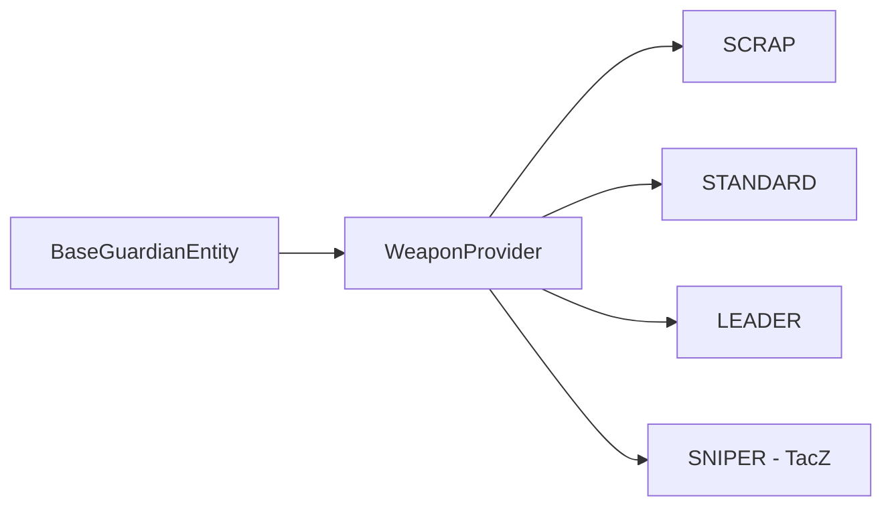

# DESIGN_CAMP_SOCIAL.md — Социальный и экономический слой лагеря

> Глава лагеря, диалоги, торговля, репутация, валюта, задания, доска объявлений, журнал,
> ферма и животные, роли оружия (включая TacZ-снайперов), генерация плана лагеря,
> радио вышка как якорь лагеря и личный лагерь.
>
> Базовые механики лагеря (модель, блоки, посты, ночь, штат) — в [`DESIGN_CAMP_SYSTEM.md`](DESIGN_CAMP_SYSTEM.md).
> Порядок реализации и приоритеты — в [`ROADMAP.md`](ROADMAP.md).

---

## 0. Зафиксированные решения владельца (основание документа)

| # | Решение |
|---|---|
| 1 | **Git введён**, проект загружен на GitHub. Бэкап-папки — только для «мусорных» экспериментов |
| 2 | Порядок: **сначала блоки** (лагерь видно), затем посты и поведение |
| 3 | Блоков на старте — **ограниченное число**, но новые блоки **не исключены** |
| 4 | Генерация — **своя**, с рандомом и вариациями; допустимы и фиксированные структуры |
| 5 | Глава лагеря — **полноценная сущность со своим интерфейсом и диалогами** (не имитация жителем) |
| 6 | Ферма — **неперегруженная**: привязанный житель собирает и складывает хлеб; забирают NPC |
| 7 | Лагерей — **логичный потолок**; **личный лагерь — один**, и его якорь — **радио вышка**: уничтожил вышку — потерял лагерь |
| 8 | **TacZ — дополнение** (снайперы на ночном дежурстве); оружие выдаётся **не всем**: у обычных — старое, у главы — сильнее |

---

## 1. Глава лагеря: своя сущность, свой интерфейс, диалоги

### 1.1 Сущность

| Аспект | Решение |
|---|---|
| Класс | `CampNpcEntity extends PathfinderMob` — **одна сущность на все роли** лагеря |
| Роли | `LEADER` (глава), `FARMER` (фермер), `CARRIER` (грузчик), `TRADER` (торговец, позже) |
| Роль хранится | в `SynchedEntityData` (`DATA_ROLE`) + в NBT |
| Внешний вид | Собственный рендерер + модель на базе `HumanoidModel` (гуманоид) |
| Анимации | Процедурные (без `Animation`-регистрации — дешевле): дыхание, покачивание, поворот головы за игроком, жест при разговоре, «взвод» при торговле |
| Здоровье | Неуязвим к урону от мобов (лагерь его защищает) — но可以被 убит игроком → последствия |

> **Почему одна сущность, а не четыре.** Каждая новая сущность = регистрация типа, рендерер, модель, анимации, `SynchedEntityData`, NBT, спавн-логика, баланс. Четыре NPC = ×4 работы. Одна NPC с ролью — ×1.

### 1.2 Диалог

ПКМ по главе → открывается **свой экран** [`CampDialogScreen`](src/main/java/com/phian404/survivalpoints/client/screen/CampDialogScreen.java):

```
┌──────────────────────────────────────────────┐
│  ГЛАВА ЛАГЕРЯ «РЖАВЫЙ БОР»        Репутация ●●○ │
│  «Кто-то всё-таки донёс радио. С чем пойдёшь?» │
├──────────────────────────────────────────────┤
│  [ Торговать ]   [ Задания ]   [ О лагере ]   │
│  [ Продать ]     [ Уйти ]                      │
└──────────────────────────────────────────────┘
```

- Текст реплик — набор по роли и репутации (`Component`), с вариациями.
- Реакция главы на действия игрока пишется в чат (`player.displayClientMessage(...)`) — дёшево и читаемо.
- Звук открытия/закрытия — `SoundEvents` (ванильные), никаких новых ресурсов.

**Стоимость:** экран ~180 строк, пакеты ~60, логика реплик ~120.

### 1.3 Анимации UI (чтобы «не было скучно»)

| Приём | Сложность |
|---|---|
| Плавное появление панели (ease-out, 150 мс) | ~20 строк на экран |
| Иконки с «дрожанием» при отрицательной репутации | ~15 строк |
| Прогресс-бар с плавной интерполяцией | ~20 строк |
| Подсветка доступных действий при наведении | ~15 строк |
| Звук клика и подтверждения | ~10 строк (используем ванильные звуки) |
| Анимация бумажек на доске объявлений | требует `BlockEntityRenderer` — отдельная задача |

> **Правило:** анимация должна быть **дешёвой** (интерполяция позиции/альфы), а не шейдерной. Плавность важнее сложности.

---

## 2. Торговля

### 2.1 Модель предложений — ванильная

Используем `net.minecraft.world.item.trading.MerchantOffers` и `MerchantOffer` (проверено в 1.20.1). Что это даёт бесплатно:

| Возможность | Как |
|---|---|
| Скидка/наценка | `MerchantOffer#getSpecialPriceDiff` / `addToSpecialPriceDiff` |
| Дефицит товара | `setToOutOfStock()` / `isOutOfStock()` |
| Лимит сделок | `getMaxUses` / `increaseUses` / `resetUses` |
| Спрос-спрос-предложение | `updateDemand()` |
| Сериализация | `createTag()` / `MerchantOffers(CompoundTag)` |

**Важно:** ванильский `MerchantScreen`/`MerchantMenu` в 1.20.1 жёстко привязаны к сущности `net.minecraft.world.item.trading.Merchant` (то есть к жителю-торговцу). Раз глава — **наша** сущность, значит торговый экран **свой**, а вот *модель предложений* — ванильная. Это ровно то разделение, которое нужно.

### 2.2 Свой торговый экран

[`CampTradeScreen`](src/main/java/com/phian404/survivalpoints/client/screen/CampTradeScreen.java): список предложений (иконка, 2–3 предмета, количество, цена), клик → пакет на сервер → сервер проверяет инвентарь, репутацию, лимит сделок → выдаёт предмет.

**Правило авторитетности:** сервер решает всё, клиент только рисует. Никаких «клиент попросил — клиент дал».

**Стоимость:** ~320 строк (экран + пакеты + серверная валидация).

### 2.3 Ассортимент

| Категория | Примеры | Откуда |
|---|---|---|
| Еда | Хлеб, пшеница, сушёное мясо | Склад лагеря |
| Оружие | Арбалет, стрелы, кожа+железо (крафт-набор) | Склад лагеря |
| Боеприпасы | Стрелы, «бумага» (ружейные патроны, если TacZ) | Склад лагеря |
| Ремонт | Починить забор/ворота (услуга) | Услуга |
| Инструменты | Кирка, топор (для ремонта лагеря игроком) | Склад лагеря |
| Ресурсы | Кожа, шкуры, железо, пшеница | Принимаем от игрока |

### 2.4 Валюта: жетон + бартер (рекомендация)

Три варианта:

| Вариант | Плюсы | Минусы |
|---|---|---|
| **A. Только бартер** (кожа → патроны) | Ноль новой экономики, интуитивно | Неудобно: «хлеб за 3 кожи и 2 пшеницы» — не масштабируется; цены не выражают ценность |
| **B. Жетон (свой предмет) + бартер как альтернатива** | Единая мера + гибкость; жетоны капают за квесты и репутацию | Новый предмет, нужно продумать источник и сток |
| **C. Полноценная валюта со ставками** | Глубокая экономика | Отдельная мини-игра, баланс, уязвимость к инфляции |

**Рекомендация — B.**
- Предмет `CampTokenItem` («жетон лагеря» / «скрип»).
- Цена в интерфейсе: `5 жетонов` **или** `3 кожи + 2 пшеницы` — игрок выбирает, что отдать.
- Источники жетонов: выполнение заданий, репутация, сдача ресурсов лагерю.
- Сток: лагерь выдаёт жетоны по репутации (растёт) — то есть репутация = «доля в прибыли».

---

## 3. Репутация

### 3.1 Модель

Репутация — пара **(игрок, лагерь)**: целое значение `−100 … +100` и уровень:

| Уровень | Диапазон | Что меняется |
|---|---|---|
| `HOSTILE` | −100 … −40 | Стражи лагеря **атакуют** игрока; торговля закрыта; заданий нет |
| `WARY` | −39 … −1 | Торговля по «завышенным» ценам, только базовый ассортимент |
| `NEUTRAL` | 0 | Базовые цены, базовые задания |
| `FRIENDLY` | +1 … +40 | Скидка до 10%, доступны обычные задания, лагерь зовёт игрока на помощь |
| `TRUSTED` | +41 … +100 | Скидка до 20%, доступны редкие задания и «улучшенные» товары, лагерь делится ресурсами, готова принять личный лагерь рядом |

### 3.2 На что влияет (запрос владельца — закрыт полностью)

| Влияние | Механика | Приоритет |
|---|---|---|
| **Цены** | `priceMultiplier = 1.0 − rep × 0.002` (до −20% у `TRUSTED`), +15% у `WARY` | Волна 5 |
| **Ассортимент** | Уровень определяет, какие `MerchantOffer` вообще доступны | Волна 5 |
| **Враждебность** | `HOSTILE` → стражи лагеря получают игрока как цель (кроме тех, кто на посту) | Волна 5 |
| **Задания** | Уровень определяет доступные типы заданий и награды | Волна 6 |
| **Доступ** | `HOSTILE` → в лагерь не пускают (ворота закрыты, подсказка «нас не ждут») | Волна 5 |
| **Вызов** | `FRIENDLY+` → лагерь зовёт игрока, когда рядом атака | Волна 6 |
| **Торговля между лагерями** | Репутация игрока в лагере A влияет на отношение лагеря B (передаётся по радио) | Волна 9 |
| **Починка** | `TRUSTED` → починка заборов бесплатно (только ресурсы) | Волна 6 |

### 3.3 Хранение и распространение

- Хранение: в [`CampSavedData`](src/main/java/com/phian404/survivalpoints/camp/CampSavedData.java) — карта `playerUuid → { campId → rep }`. Лагерь **знает** отношение к игроку (нужно для враждебности и торговли).
- Клиент получает своё значение репутации по лагерю через пакет — для отрисовки в UI.
- **Распространение между лагерями:** при торговле/знакомстве лагерь A сообщает лагерю B: «игрок X — наш союзник / подозрительный». Коэффициент 0.5, только для `TRUSTED`/`HOSTILE`. Это отдельная механика (волна 9).

---

## 4. Задания, доска объявлений, журнал

### 4.1 Типы заданий

| Тип | Описание | Пример | Награда |
|---|---|---|---|
| `KILL` | Убить N мобов типа X | 8 зомби | Жетоны + репутация |
| `COLLECT` | Принести из мира ресурс | 5 кож, 3 пера | Жетоны + репутация |
| `DELIVER` | Сдать предметы в лагерь | 10 пшеницы на склад | Репутация + еда в лагере |
| `REPAIR` | Починить разрушенный участок | 12 дерева | Репутация, снятие деградации |
| `DEFEND` | Отбить атаку на лагерь | пережить 3 волны | Жетоны, улучшение снаряжения |
| `FARM` | Собрать урожай в теплице | 6 пшеницы | Еда в лагере |

### 4.2 Доска объявлений

- **Блок** `CampBoardBlock` + `BlockEntity`: на доске висит 1–3 бумажки с доступными заданиями.
- **Сначала** (дёшево): ПКМ по доске → экран со списком заданий лагеря (свой `Screen`, ~150 строк) → «Принять» → задание уходит в журнал.
- **Потом** (красиво): свой `BlockEntityRenderer`, рисующий бумажки с лёгкой анимацией (покачивание) — визуально доска «живая» без единой строчки серверной логики.
- Формат хранения: набор доступных заданий лагеря — в `CampRecord`; принятые игроком — в данных игрока (см. §4.4).

### 4.3 Журнал заданий (отдельная кнопка)

- Хоткей через `RegisterKeyMappingsEvent` (Forge 1.20.1) — например, `J` (конфликт с чатом → выбираем свободную).
- Экран [`QuestJournalScreen`](src/main/java/com/phian404/survivalpoints/client/screen/QuestJournalScreen.java):
  - **слева** — список активных заданий: название, прогресс (`3/8`), срок/цель;
  - **справа** — детали: описание, награда, кто выдал (глава лагеря), координаты лагеря;
  - **внизу** — репутация по известным лагерям (уровень цветом) и их координаты;
  - кнопки: «Отслеживать» (в мире рисуется маркер/путь), «Сдать» (если выполнено), «Отказаться».
- Клиентское состояние: [`ClientQuestState`](src/main/java/com/phian404/survivalpoints/client/ClientQuestState.java) — список заданий + репутации, обновляется пакетом `SyncJournal`.

### 4.4 Где хранить задания игрока

| Вариант | Плюсы | Минусы |
|---|---|---|
| **В `CampSavedData`** (карта `playerUuid → quest list`) | Лагерь видит задания игрока (может звать, проверять сдачу) | Данные лагеря растут; смешение сюжета лагеря и игрока |
| **В NBT игрока** (`player.getPersistentData()`) | Просто, рядом с инвентарём | Лагерь не видит без запроса; при переносе мира — ок |
| **Отдельный `PlayerCampData` (SavedData per player)** | Чисто, масштабируется | Лишний класс и тик |

**Рекомендация:** NBT игрока для самих заданий + **дубль «активных» заданий в `CampRecord`** (только id и прогресс), чтобы лагерь мог показывать «кто заказчик» и реагировать. Компромисс: источник истины — NBT игрока, лагерь видит копию.

### 4.5 Прогресс заданий

- События: `LivingDeathEvent` (kill), `PlayerEvent.ItemPickupEvent` (collect), `BlockEvent.BreakEvent` (repair/collect), `LivingDamageEvent` (defend).
- Счётчики обновляются на сервере, в журнал уходит пакет с новым прогрессом (только при изменении — не спамить).

---

## 5. Ферма, еда и животные (без перегрузки)

### 5.1 Схема «неперегруженной» фермы


| Звено | Реализация | Код |
|---|---|---|
| Сбор урожая | **Житель с профессией `FARMER`** + наш `Goal` (найти зрелую грядку → сломать → подобрать → положить в сундук) | ~120 строк |
| Хлеб | Правило «3 пшеницы → 1 хлеб» (ванильный рецепт) в тике склада | ~15 строк |
| Разбор хлеба | **Грузчик** (роль `CARRIER` у `CampNpcEntity`): подходит к сундуку, забирает хлеб, относит на склад/к голове | ~90 строк |
| **Иллюзия** | Если NPC-грузчика нет — сундук «опустошается» с частицами и звуком, инвентарь NPC визуально полон | ~20 строк |
| Питание стражей | [`GuardianEatBreadGoal`](src/main/java/com/phian404/survivalpoints/entity/ai/GuardianEatBreadGoal.java) берёт хлеб **из склада лагеря**, а не из мира | ~40 строк правок |

### 5.2 Ванильный житель как фермер — почему это дёшево

- Мы **не создаём** новую сущность: спавним обычного `Villager` с тегом `sp_farm_<campId>` и добавляем ему свой `Goal` в `goalSelector`.
- Профессия `FARMER` даёт ему визуал (кепка) без единой строки кода.
- Убили/сменили — лагерь теряет фермера: задание «найти/привести нового», ферма простаивает.

### 5.3 Животные: да, но без новых сущностей

- **Ванильные** куры/коровы с тегом `sp_livestock_<campId>` и счётчиком поголовья в `CampRecord`.
- Никаких новых типов сущностей: счётчик + тег.
- **Что будет, если убить животных:**
  1. поголовье падает → **производство еды падает** (меньше яиц/молока → меньше хлеба/еды);
  2. у лагеря появляется **задание** «восстановить поголовье»;
  3. **репутация падает** (лагерь просит игрока помочь);
  4. если поголовье = 0 — лагерь живёт на припасах, риск голода → часть стражей голодает (стреляют хуже) — мягкая деградация.
- Корм: если поголовье есть и рядом с грядками — потребляет пшеницу (съедает урожай) → конфликт «ферма vs скот» решается размещением (ферма отгорожена) — это как раз «постапокалиптическая» деталь.

### 5.4 Что не делаем

- Не делаем «собственную систему роста» — ванильная грядка уже считает рост, воду и климат.
- Не делаем отдельный класс «пекаря» — правило 3:1 в тике склада.
- Не делаем раздельные «ферма/скот/пекарня» как три системы — один склад + один счётчик.

---

## 6. Оружие и тактические роли (TacZ)

### 6.1 Роли

| Роль | Кто | Оружие | Когда |
|---|---|---|---|
| `SCRAP` | Обычные стражи (большинство) | **Старое/некачественное**: арбалет с плохим уроном, или «обмотанный» арбалет | Постоянно |
| `STANDARD` | Часть стражей | Обычный арбалет | Постоянно |
| `LEADER` | Глава лагеря | **Силenое** оружие (лучший арбалет/ TacZ-пистолет) | Постоянно |
| `SNIPER` | 1–2 стража на вышках | **TacZ: винтовка/снайперская** | **Только ночью**, только с вышки |

### 6.2 Правила (по запросу владельца)

- Оружие **выдаётся не всем**: у большинства — «старое» (меньше урона, быстрее ломается), у главы — посильнее.
- Снайперы выходят **только на ночное дежурство** и **только на вышках**.
- Баланс снайпера: **дальний выстрел, но медленный** (перезарядка 3–5 с), урон ×1.5–2 к арбалету, но **обязана быть линия огня** и **несколько секунд на прицеливание** (уже есть «взвод» через [`PRE_SHOT_DELAY_TICKS`](src/main/java/com/phian404/survivalpoints/init/GuardianTuning.java)).
- Без TacZ роли `SNIPER`/`LEADER` используют арбалеты — мод работает самодостаточно.

### 6.3 Модель оружия



- `WeaponProfile` — интерфейс: `getDamage()`, `getSpeed()`, `getCooldown()`, `getRange()`, `getProjectile()`.
- `WeaponTier` — enum: `SCRAP / STANDARD / LEADER / SNIPER` + множители урона/дальности/скорости.
- `TaczFirearmProfile` — только если `ModList.get().isLoaded("tacz")` (soft-dep, без `compileOnly` на артефакт — чтобы не ломать сборку).
- Выдача оружия: арсенал лагеря (`CampRecord.arsenal`) → при найме/смене роли глава выдаёт предмет; **износ** через `ItemStack` durability → израсходовался → замена из арсенала, иначе стражи остаются с пустыми руками.

### 6.4 Что делаем в первую очередь (без TacZ)

Роли `SCRAP / STANDARD / LEADER` на арбалетах — **работает сразу**, без новых зависимостей, и даёт 80% эффекта «не всем одинаковое оружие». TacZ добавляется последней, меняя только реализацию `WeaponProfile` для ролей `LEADER`/`SNIPER`.

---

## 7. Генерация лагеря: блюпринты + вариации

### 7.1 Разбор вариантов

| Подход | Плюсы | Минусы | Вердикт |
|---|---|---|---|
| **Фиксированные структуры** (`StructureTemplate`, `.nbt`) | Красиво, «как в редакторе» | Нужны файлы структур, нет лёгкой вариативности, сложно править в коде | Как **один** из слоёв |
| **Чисто процедурная генерация** | Бесконечная вариативность | Может выглядеть «случайно», трудно гарантировать читаемый периметр | Не в чистом виде |
| **ASCII-блюпринты + трансформации + процедурная рассадка** | Читаемо, легко править, вариативно, ноль внешних библиотек | Нужно написать парсер (~60 строк) | **Рекомендация** |

### 7.2 Слои вариации

| Слой | Что варьируется | Как |
|---|---|---|
| 1. Планировка | 3–4 блюпринта: «аванпост», «крепость», «посёлок», «развилка» | Выбор по RNG + по размеру лагеря |
| 2. Ориентация | Поворот 0/90/180/270 + зеркалирование | Трансформация координат |
| 3. Размер | Маленький (радиус 16) / средний (24) / большой (32) | Масштабирование или отдельные блюпринты |
| 4. Рассадка | Положение ворот, число вышек, позиции постов, ловушки | Процедурно внутри периметра |
| 5. Наполнение | Теплица, склад, доска объявлений, радио — ставятся в «свободные места» | Поиск свободной клетки внутри периметра |

### 7.3 Формат блюпринта

Символьная сетка, читается прямо в коде:

```
// F=забор  G=ворота  T=вышка  W=склад  R=радио  B=доска  .=пусто
```
```
F F F F F F F
F T . . . T F
F . W R B . F
F . . G . . F
F F F F F F F
```

- Парсер: 1 строка на символ, ~60 строк на весь парсер.
- Блюпринт = `String[]` + метаданные (радиус, точки входа).
- Хранить в **ресурсах** (`assets/survivalpoints/camps/*.txt`) — правится без перекомпиляции; или в коде — проще для начала. Рекомендация: **в коде** на первом этапе (минимум файлов), перенести в ресурсы позже.

### 7.4 Гарантии генерации

- Периметр всегда замкнут (забор без дыр, кроме ворот).
- Ворота — ровно одна пара, всегда на одной из 4 сторон.
- Вышки — на углах, всегда ≥2.
- Радио — в центре (или в тылу).
- Проходы внутри — шириной ≥2, чтобы стражи проходили (иначе лагерь «замурован»).

### 7.5 Стоимость

| Часть | Строк |
|---|---|
| Парсер блюпринта | ~60 |
| Трансформации (поворот/зеркало/масштаб) | ~80 |
| Посадка блоков в мир | ~80 |
| Процедурная рассадка (ворота/вышки/посты) | ~120 |
| **Итого** | **~340** |

Сравните с `StructureTemplate`-подходом: там нужны `.nbt`-файлы (их ещё надо где-то сделать) и нет лёгкой вариативности. **Гибрид**: блюпринты задают «скелет», процедурная часть — «мясо».

---

## 8. Радио вышка как якорь лагеря

### 8.1 Правила

| Правило | Описание |
|---|---|
| **Якорь** | Лагерь существует, пока стоит его **радио вышка**. Вышка = сердце лагеря (заменяет отдельный «маяк») |
| **Создание** | Игрок ставит радио вышку → создаётся лагерь (если не превышен потолок и нет своего лагеря) |
| **Потолок** | Мировых лагерей — ограниченное число (напр. 3–4 на мир). **Личный лагерь — 1 на игрока** |
| **Уничтожение** | Вышка уничтожена → лагерь распадается: посты и привязки исчезают, склад **выпадает** в сундук (чтобы не пропало), стражи теряют лагерь и уходят в «свободные» |
| **Восстановление** | Поставил вышку на том же месте → можно «восстановить» лагерь (репутация сохраняется?) — решение владельца |

### 8.2 Почему вышка, а не отдельный маяк

- **Минус блоков**: не нужен отдельный «маяк» — радио вышка и есть сердце.
- **Логическая связка**: вышка = связь = призыв выживших = якорь; всё в одном объекте.
- **Драматургия**: игрок, чтобы получить выжившего, должен построить вышку → это и есть «создание лагеря».

### 8.3 Блок `CampRadioBlock` + `BlockEntity`

- Хранит: `campId`, радиус, режим (день/ночь), заряд (нужен для работы), «последний вызов».
- ПКМ: открыть панель лагеря (статистика, состав, радио-объявление) — простой экран.
- Разрушение: `BlockEvent.BreakEvent` → распад лагеря.
- Ночью: не работает (заряд тратится только днём).

---

## 9. Пересмотренные волны реализации

| Волна | Содержание | Новых блоков | Новых сущностей | Новых экранов | ≈ строк |
|---|---|---|---|---|---|
| **0** | Починить качели | 0 | 0 | 0 | ~60 |
| **1** | Данные лагеря: `CampTuning`, `CampRecord`, `CampPost`, `CampSavedData`, `CampManager`, `/sp_camp` | 0 | 0 | 0 | ~450 |
| **2** | Якорь + генерация: `CampRadioBlock`, блюпринты, забор, ворота | 3 | 0 | 0 | ~700 |
| **3** | Посты: `campId`/`postId`, `GuardianPostGoal`, зона тревоги, ночь, вышка | 1 | 0 | 0 | ~500 |
| **4** | Еда: склад-блок, фермер-житель, грузчик, хлеб, кормление стражей | 1 | 0 | 0 | ~450 |
| **5** | **UI-волна I:** `CampNpcEntity` + рендерер, диалог, торговля, репутация | 0 | 1 | 2 | ~1100 |
| **6** | **UI-волна II:** задания, доска объявлений, журнал + хоткей | 1 | 0 | 2 | ~900 |
| **7** | Животные и поголовье, деградация/починка | 0 | 0 | 0 | ~300 |
| **8** | Роли оружия (`SCRAP/STANDARD/LEADER`) + TacZ-снайперы | 0 | 0 | 0 | ~600 |
| **9** | Отношения между лагерями, торговля по радио | 0 | 0 | 1 | ~500 |
| **10** | Личный лагерь (потолок 1, якорь = вышка) | 0 | 0 | 0 | ~250 |

> **UI-волны (5 и 6) — самые дорогие.** Их можно делать **после** того, как лагерь признан рабочим (волны 1–4). Если бюджет ограничен — резать волну 6 (задания), а не волну 5: без главы лагерь не общается с игроком вообще.

---

## 10. Риски социального слоя

| Риск | Признак | Контрмера |
|---|---|---|
| **UI дороже, чем сама механика** | Экран занимает больше кода, чем лагерь | Сначала данные и сервер, потом экран; простые экраны без анимаций, анимации — в последнюю очередь |
| **Баланс репутации** | Игрок фармит репутацию одной задачей | Ограничение: задания не начисляют репутацию чаще раза в N минут; cap по типу задания |
| **Экономика жетонов** | Инфляция или дефицит | Жетоны выдаются за **репутацию и задания**, а не за добычу → дефицит → иллюзия ценности |
| **Рассинхрон UI и данных** | Экран показывает не то | Всё решение — на сервере; клиент только рисует; пакеты — по изменению состояния |
| **Пакеты не долетают** | Журнал пуст | Один пакет «полная синхронизация» при открытии экрана + дельты при изменениях |
| **Слишком много NPC** | Лагерь = 10 сущностей | Роли: глава (1) + фермер (1) + грузчик (1) = 3 NPC; остальные — стражи |
| **Снайперы слишком сильны** | Ночь выглядит пустой | 1 снайпер на лагерь, перезарядка 3–5 с, нужен разгон/прицеливание, только ночью |
| **Потеря лагеря = потеря игрока** | Игрок не понимает, что произошло | При распаде — сообщение в чат, лагерь восстанавливается при постройке вышки на старом месте |

---

## 11. Решения, требующие уточнения у владельца

1. **Валюта:** жетон + бартер (рекомендация) или чистый бартер? Разрешаем ли смешанную оплату («5 жетонов **или** 3 кожи»)?
2. **Репутация и враждебность:** при `HOSTILE` стражи лагеря **атакуют** игрока? И как долго — до смерти игрока, до выхода с территории, «пока не уйдёшь»?
3. **Порог репутации** для враждебности: −40 (моё предложение) или мягче, −20?
4. **Распространение репутации между лагерями:** сразу или в волне 9?
5. **Животные:** добавляем поголовье (куры/коровы, ванильные, с тегом)? Их еда конфликтует с фермой — разделяем территорию или оставляем «съедают урожай» как последствие?
6. **Снайперы:** подтверждаем «только ночью, только с вышки, 1 на лагерь, перезарядка 3–5 с»?
7. **Блюпринты:** сколько фиксированных планировок (3?) и размеры (16/24/32)?
8. **Порядок UI:** сначала торговля+репутация (волна 5) или сначала задания+журнал (волна 6)?
9. **Распад лагеря:** склад выпадает в сундук (рекомендация) или теряется? Репутация игрока сохраняется?
10. **«Живой» NPC-грузчик:** нужен ли отдельный видимый NPC, или хватит иллюзии (сундук пустеет, частицы)?

---

## 12. Связанные документы

- [`DESIGN_CAMP_SYSTEM.md`](DESIGN_CAMP_SYSTEM.md) — базовая модель лагеря: блоки, посты, ночь, штат, данные.
- [`ROADMAP.md`](ROADMAP.md) — приоритеты, волны, зависимости, риски, бюджеты.
- [`PROJECT_VISION.md`](PROJECT_VISION.md) — замысел мода и список механик.
- [`AI_CONTEXT.md`](src/main/java/com/phian404/survivalpoints/AI_CONTEXT.md) — состояние кода и правила работы.
